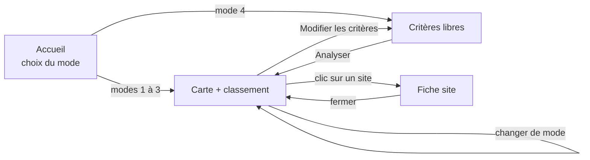

# Parcours utilisateur et maquettes

Maquette cliquable : [maquettes/index.html](maquettes/index.html) (à ouvrir dans un navigateur). Les valeurs des sites sont **fictives** ; les modes, paramètres et intervalles viennent de [scenarios.md](scenarios.md). Le score est calculé avec la formule du README pour que le classement de la maquette soit cohérent.

La case « Annotations API » (en haut à droite) affiche, sur chaque bloc, la route qui l'alimente.

## Parcours

1. **Accueil** : la question du défi, le site lunaire de référence, 4 cartes de mode, et les limites de l'analogie.
2. **Carte** : liste classée à gauche, carte à droite (couleur = score). En mode 2, l'utilisateur choisit les instruments à calibrer. Les sites exclus par le filtre végétation restent visibles, en fin de liste et en gris.
3. **Fiche site** : score sur 100, usage possible, « correspond » (critère ≥ 0,7) et « ne correspond pas » (< 0,4), barre par critère avec la valeur du site et la valeur souhaitée, rappel de ce que la Terre ne reproduit pas.
4. **Critères libres (mode 4)** : un tableau du catalogue ; on coche un paramètre, puis on indique minimum, maximum, marge et importance (1 à 3). On peut partir des réglages d'un mode 1 à 3. Le filtre végétation est coché par défaut.

États prévus (sélecteur « État démo » sur l'écran Carte) : **chargement** (avec l'état de chaque source), **erreur de source** (réessayer ou continuer sans elle), **aucun résultat**. Sur mobile, la carte passe au-dessus de la liste et la fiche s'ouvre en plein écran.

## Données attendues de l'API par écran

| Écran | Route | Champs utilisés |
|---|---|---|
| Accueil | `GET /api/modes` | `id`, `name`, `question`, `audience` (public visé) |
| Accueil | `GET /api/reference/moon` | nom et coordonnées du site lunaire de référence |
| Carte | `POST /api/analyze` | par site : `id`, `name`, `region`, `lat`, `lon`, `kind` (`known` / `control` / `new`), `score` (0-100), `excluded` (bool), `criteria[]` |
| Fiche | `POST /api/analyze` ou `GET /api/sites/{id}` | par critère : `param`, `group` (instrument ou besoin), `value`, `min`, `max`, `tolerance`, `weight`, `score` (0-1) ; `usage` (texte) |
| Mode 4 | `GET /api/parameters` | `id`, `label`, `help`, `unit`, `min`, `max` (bornes du catalogue) |
| Chargement / erreur | `POST /api/analyze` | statut par source en cas d'échec partiel (`sources[]: { name, status }`), pour afficher « continuer sans MODIS » |

## À valider avec Jesus et François-Xavier avant le gel du contrat (sam 17 h 30)

- [ ] `label` et `help` servis par `/api/parameters` et `/api/modes`, ou fichier de textes côté front ?
- [ ] `kind` du site (analogue connu, témoin, peu étudié) fourni par `data/candidates.json` et renvoyé par l'API.
- [ ] `excluded` renvoyé par `/api/analyze` plutôt que de retirer les sites végétalisés (le témoin Amazonie doit rester visible).
- [ ] `group` sur chaque critère (instrument en mode 2, besoin en mode 3).
- [ ] Échec partiel d'une source : erreur globale, ou résultats avec la liste des sources en échec ?
- [ ] Le texte « usage possible » est-il produit par l'API ou par le front ?
