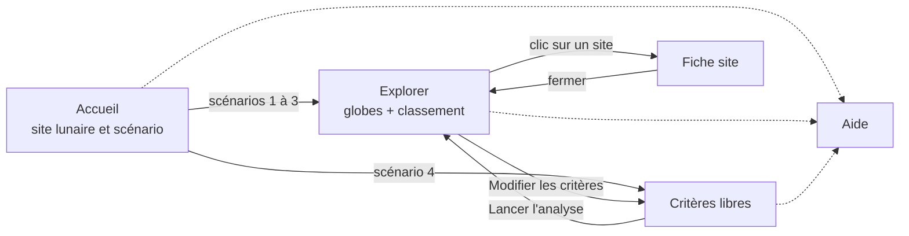
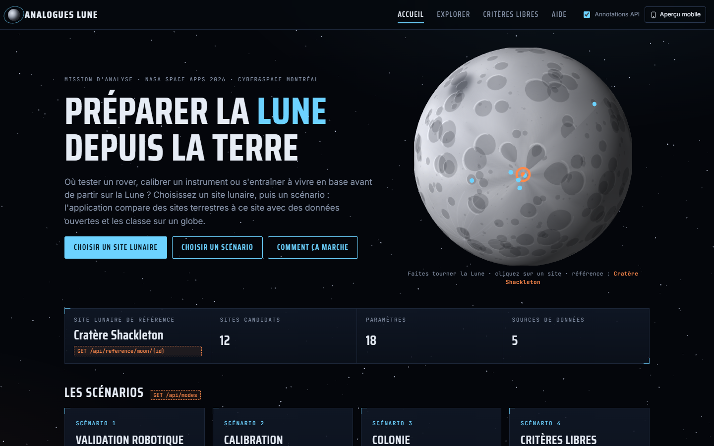
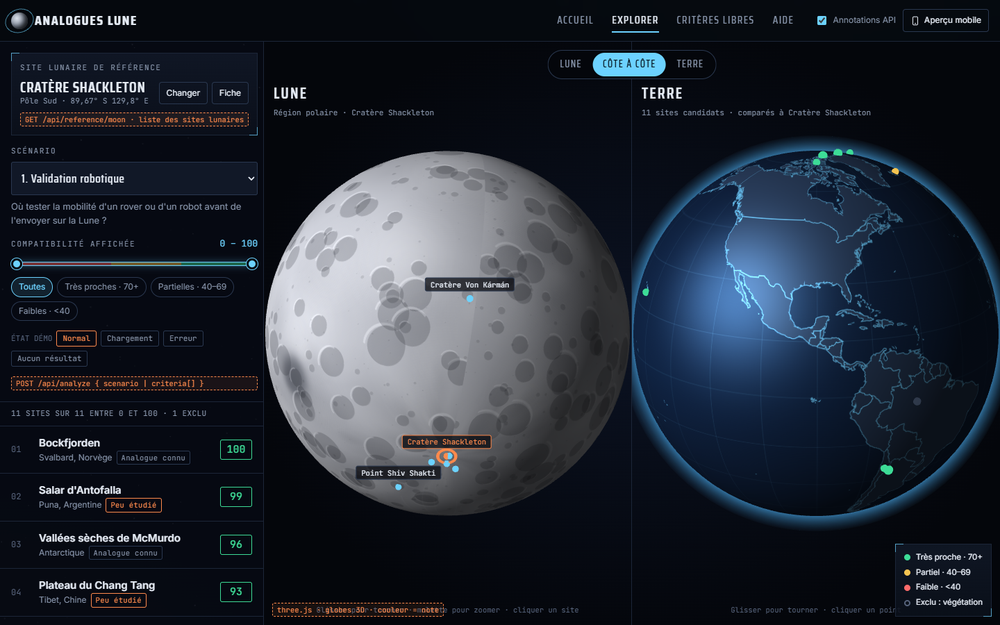
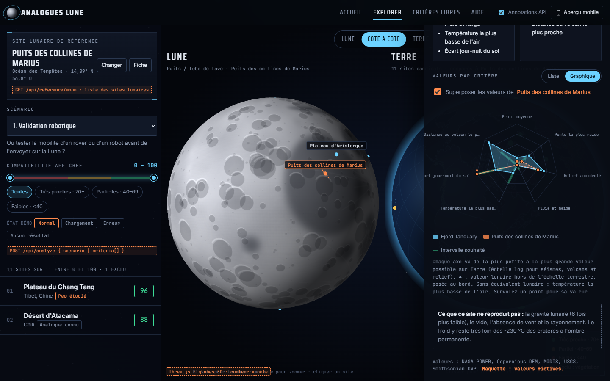
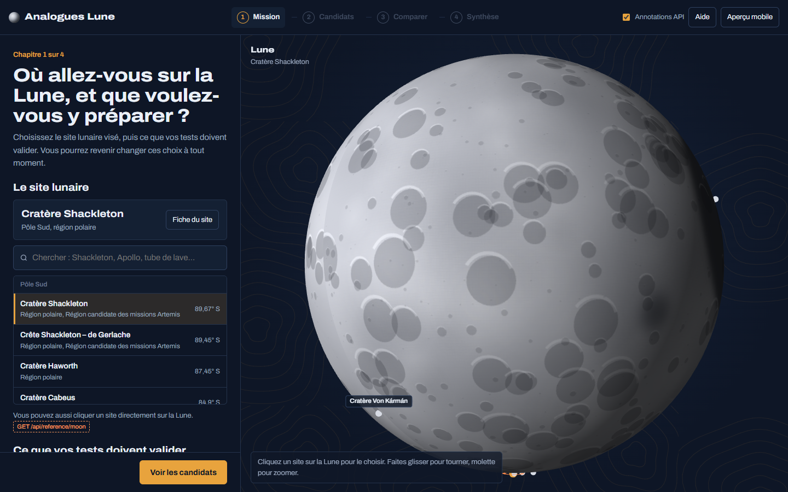
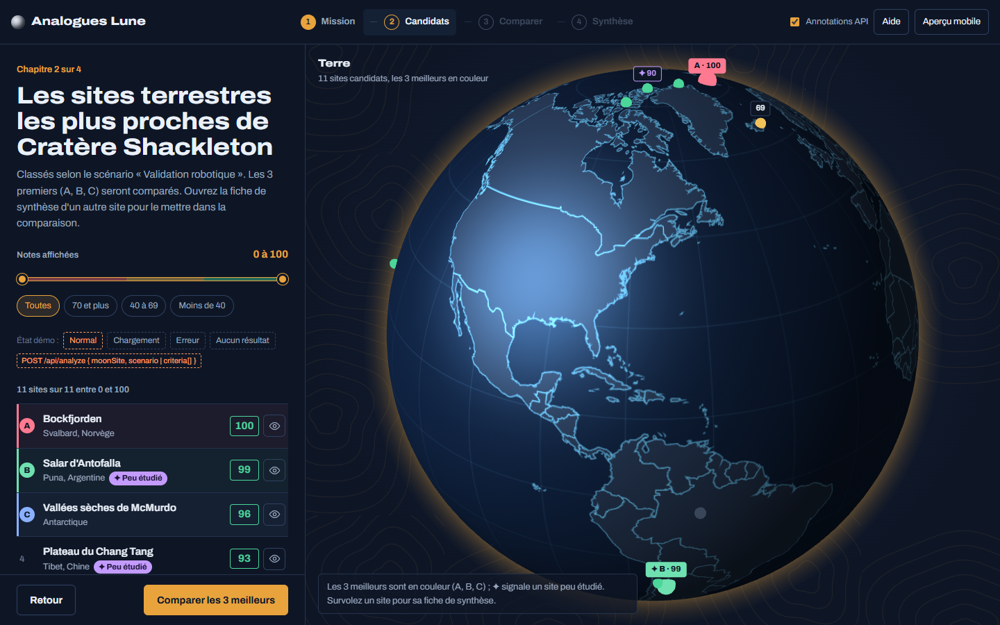
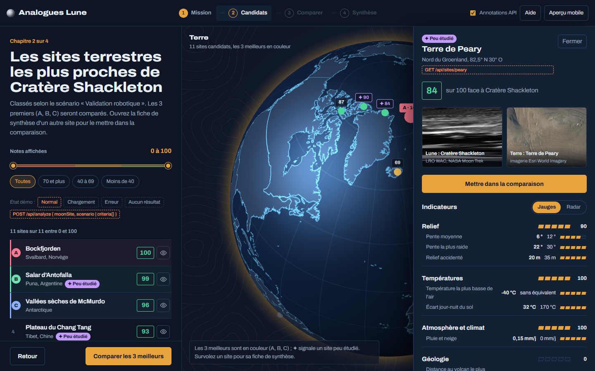
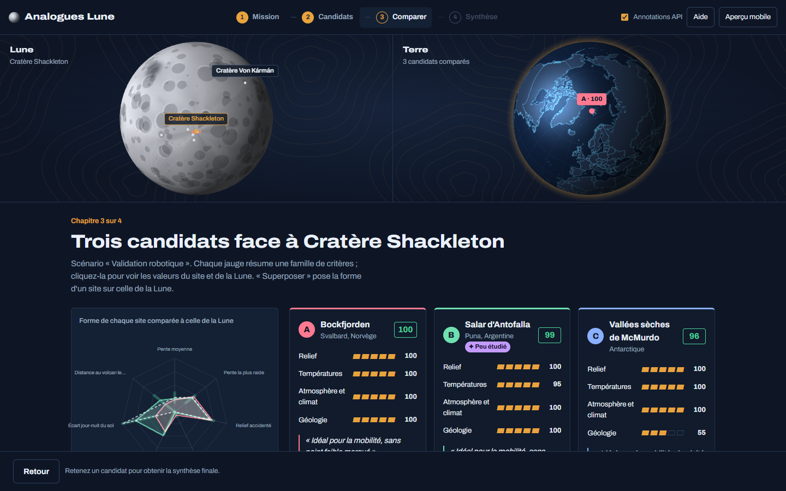
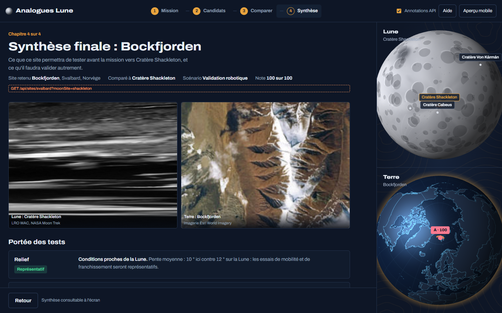
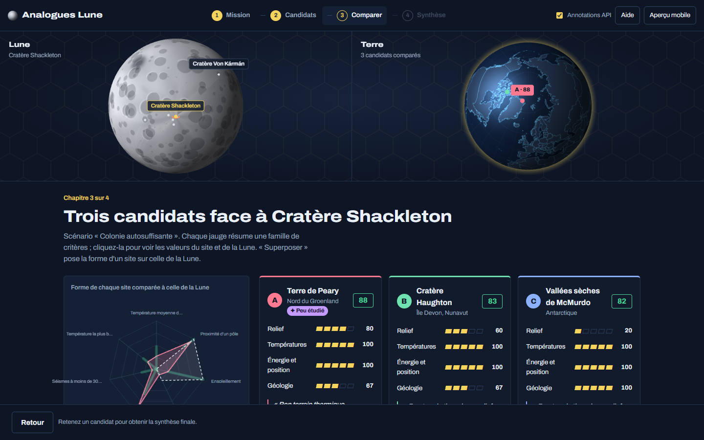

# Parcours utilisateur et interfaces

Ce document décrit le parcours utilisateur et les **deux solutions d'interface** proposées pour l'application, avec leurs maquettes cliquables et leurs captures d'écran.

| Solution | Maquette | Version en ligne (privée, à partager) | Captures |
|---|---|---|---|
| **1. Exploration libre** | [maquettes/index.html](maquettes/index.html) | https://claude.ai/artifact/C9o3z4Usii7KNmL9zMjnYS | [capture_ecran/maquette-1-exploration](capture_ecran/maquette-1-exploration) |
| **2. Parcours narratif en 4 chapitres** | [maquettes/parcours.html](maquettes/parcours.html) | https://claude.ai/artifact/MrV1KPvZU9bHzXnpXP2FBM | [capture_ecran/maquette-2-parcours](capture_ecran/maquette-2-parcours) |

Les maquettes s'ouvrent directement dans un navigateur. Les valeurs des sites terrestres sont **fictives** ; les scénarios, paramètres et intervalles viennent de [scenarios.md](scenarios.md), et la note est calculée avec la formule du README pour que les classements soient cohérents.

## Pour qui, et pour quoi faire

L'utilisateur est une personne ou une équipe qui **prépare une mission lunaire**. Elle cherche le meilleur site sur Terre pour y mener des tests avant la mission, et doit **en choisir un**.

À la fin, l'équipe doit avoir entre les mains, pour le site retenu : ses caractéristiques, ses analogies et ses différences avec le site lunaire, et donc **la portée des tests possibles et leurs limites**.

## Ce que les deux solutions ont en commun

- **Site lunaire de référence** : l'application n'est pas limitée au pôle Sud. L'utilisateur choisit parmi 14 sites (pôles, sites Apollo, puits de tubes de lave, zones volcaniques, face cachée), dans une liste avec recherche ou en cliquant un point sur une Lune en 3D. Coordonnées réelles ; caractéristiques **indicatives**, à remplacer par LOLA, Diviner et LEND.
- **Scénarios** : 1 Validation robotique, 2 Calibration d'instruments, 3 Colonie autosuffisante, 4 Critères libres. Dans l'interface, on parle de **scénario** et non de « mode » (les docs du repo et le contrat d'API disent encore « mode »).
- **Scénarios génériques** : certains critères suivent le site lunaire choisi (pente et relief au scénario 1, latitude au scénario 3 seulement pour un site polaire, volcanisme renforcé pour une mer ou un tube de lave). Ils portent la mention « adapté ». *Règle proposée, à valider par Ouassim et David* : le README prévoit un seul profil de référence (`data/reference/moon-south-pole.json`) ; il en faudrait un par site lunaire.
- **Globes 3D** (three.js) : une Terre avec les contours des continents et une Lune générée par le code. On les fait tourner en glissant, on zoome à la molette ou en pinçant, et ils se recentrent sur le site choisi.
- **Critères libres** : paramètres regroupés en thèmes repliables, double curseur par paramètre (intervalle, marge hachurée, sites candidats en points sous le curseur), importance en 3 niveaux, aperçu du classement en direct.
- **États** : chargement (avec l'état de chaque source), erreur de source (réessayer ou continuer sans elle), aucun résultat.
- **Éléments propres aux maquettes** (à ne pas développer) : la case *Annotations API* (affiche la route qui alimente chaque bloc), le bouton *Aperçu mobile* (cadre de téléphone ; la mise en page repose sur des *container queries*, donc elle vaut aussi sur un vrai téléphone) et le sélecteur *État démo*.

Interfaces dont les maquettes reprennent des principes, sans en copier l'apparence : NASA Eyes on the Solar System (globe 3D cliquable et panneau d'information), NASA Moon Trek et LROC QuickMap (recherche de lieux lunaires), Google Earth (recentrage animé, étiquettes qui suivent le globe).

## Solution 1 : exploration libre

**Principe** : une boîte à outils. L'utilisateur choisit un site lunaire et un scénario, puis explore librement une liste classée, deux globes et des fiches.

1. **Accueil** : Lune 3D cliquable, choix du site lunaire, 4 cartes de scénario, renvoi vers les limites de l'analogie.
2. **Explorer** : choix du site lunaire (liste avec recherche) et du scénario à gauche, classement des sites terrestres, filtre par plage de notes (double curseur et raccourcis), filtre par instrument au scénario 2. À droite, les vues **Lune**, **Côte à côte** et **Terre**. Les sites exclus pour végétation restent visibles en gris.
3. **Fiche du site lunaire** : type, coordonnées, intérêt, pente, relief, temps éclairé, températures du sol, glace d'eau, missions, ce que l'application cherche sur Terre.
4. **Fiche du site terrestre** : jauge de note, usage possible, « correspond » (critère ≥ 0,7) et « ne correspond pas » (< 0,4), valeurs par critère en **liste** (bulle d'information au survol) ou en **graphique de surface**, avec la superposition semi-transparente des valeurs du site lunaire.
5. **Critères libres (scénario 4)** et **Aide** (prise en main, scénarios, calcul de la note avec courbe interactive et exemple chiffré, 18 critères par famille, limites de l'analogie, glossaire de 25 termes).

| Accueil | Lune et Terre côte à côte | Fiche site terrestre, radar superposé |
|---|---|---|
|  |  |  |

Autres captures : fiche du site lunaire, fiche en liste, critères libres, aide, mobile (dossier [maquette-1-exploration](capture_ecran/maquette-1-exploration)).

## Solution 2 : parcours narratif en 4 chapitres

**Principe** : l'interface raconte la recherche comme une histoire, avec un fil logique, et **la comparaison Lune-Terre devient le cœur de l'expérience** au lieu d'une option dans une fiche.

### Objectifs, hors périmètre, échecs à éviter

- **Objectifs** : un parcours toujours dans le même ordre, qui suit le raisonnement d'une équipe de mission (la Lune d'abord, la Terre ensuite) ; la comparaison des **3 meilleurs candidats** avec leurs forces et leurs faiblesses ; une **synthèse finale** qui traduit chaque analogie ou différence en portée de test ; le retour possible à tout moment à un chapitre précédent.
- **Hors périmètre** : la présentation au jury ; le partage, l'impression et le téléchargement de la synthèse (pour le MVP, elle est **seulement consultée à l'écran**) ; les vraies données ; Mars.
- **Échecs à éviter** : un tunnel qui empêche de revenir changer un choix ; une comparaison qui redevient secondaire ; des animations qui ralentissent une équipe qui travaille ; la perte de ce que la solution 1 offre déjà (critères libres, aide, glossaire, états, aperçu mobile, annotations API).

### Approches envisagées

| Approche | Avantages | Inconvénients |
|---|---|---|
| **Parcours guidé par chapitres, avec une scène 3D commune** (retenue) | Logique, on ne se perd pas, retour en arrière facile | Réorganisation profonde de la maquette |
| Récit en défilement continu | Le plus fluide | Revenir changer un choix est pénible ; le plus lourd à construire |
| Fil conducteur posé sur l'écran de la solution 1 | Le moins de travail | La comparaison reste secondaire |

### Les 4 chapitres

Une barre des chapitres reste visible en haut ; les chapitres déjà atteints sont cliquables. À gauche le récit, à droite une **scène 3D** qui change avec le chapitre.

| # | Chapitre | Ce que fait l'utilisateur | Scène 3D |
|---|---|---|---|
| 1 | **Mission** | Choisit le site lunaire (liste avec recherche ou clic sur la Lune ; bouton **Fiche du site** en superposition) et ce qu'il veut tester. Voit la liste des **critères sur lesquels la mission sera évaluée**. Le scénario 4 ouvre l'atelier des critères libres. | Lune seule |
| 2 | **Candidats** | Voit le classement (filtre de notes, instruments au scénario 2, états). Les 3 meilleurs (A, B, C) ressortent sur le globe et dans la liste ; chaque site affiche sa note. Le survol d'un site, ou l'icône de la liste, ouvre sa **fiche de synthèse**. | Terre |
| 3 | **Comparer** | Compare les 3 candidats face au site lunaire et clique **Retenir ce site** sur l'un d'eux. | Lune et Terre côte à côte |
| 4 | **Synthèse** | Consulte la **synthèse finale** du site retenu. | Lune et Terre, site lunaire et site retenu mis en évidence |

**Fiche de synthèse** (chapitre 2) : visuels du site lunaire et du site terrestre quand ils sont disponibles, indicateurs au choix en **jauges** ▰▰▰▰▱ (par famille et par critère, avec la valeur lunaire) ou en **radar** (surface lunaire superposée), résumé, bouton « Mettre dans la comparaison ».

**Comparaison** (chapitre 3) : une carte par candidat avec une jauge par famille de critères (un clic ouvre les valeurs du site et de la Lune), une phrase de verdict, « Ce qui joue en sa faveur » et « Ce qu'il faudra compenser ». À gauche, un radar où la forme de la Lune sert de fond et où l'on superpose la forme des candidats choisis.

**Synthèse finale** (chapitre 4), titrée « Synthèse finale : [site] » :
1. en-tête : site retenu, site lunaire, scénario, note, visuels des deux sites ;
2. **portée des tests** par famille, en trois niveaux (Représentatif, Partiel, Non représentatif), avec une phrase liée au type de test (mobilité, tests thermiques, calibration de capteurs, forage et sismique, énergie solaire) et le moyen de compléter (chambre thermique à vide, laboratoire, simulation…) ;
3. le bloc permanent **« Jamais reproductible sur Terre »** : gravité, vide, rayonnement ;
4. **analogies et différences** critère par critère (valeur terrestre, valeur lunaire, valeur souhaitée, niveau) ;
5. **caractéristiques** du site : les 18 paramètres, par famille.

### Règles de calcul et de navigation

- **Analogie (option A)** : le classement, les jauges et le verdict gardent la note du scénario. Dans la synthèse, un critère bien noté mais encore loin de la valeur lunaire passe en « Partiel ». Exemple : écart jour-nuit du sol de 25 °C contre 170 °C sur la Lune, donc tests thermiques à compléter en chambre thermique à vide.
- **Trio comparé** : les 3 meilleurs sites non exclus. Le filtre par instrument le recalcule ; la plage de notes ne filtre que l'affichage. Un site ajouté à la main reste dans le trio tant qu'il figure dans les résultats. Avec moins de 3 candidats, on compare ceux qui restent ; sans candidat, les chapitres suivants restent verrouillés.
- **Retour en arrière** : changer le site lunaire, le scénario ou les critères recalcule le classement. Le site retenu est annulé seulement s'il sort du trio, et l'utilisateur en est prévenu.
- **Ambiance selon le scénario** : couleur d'accent, motif de fond de la scène et halo de la Terre (robotique : ocre et courbes de niveau ; instruments : cyan et grille d'oscilloscope ; colonie : or et trame d'habitat ; critères libres : neutre).
- **Sites peu étudiés** : pastille « ✦ Peu étudié » partout (liste, globe, fiches, cartes, synthèse).
- **Visuels** : mosaïque LRO WAC de NASA Moon Trek pour la Lune, imagerie Esri World Imagery pour la Terre, chargées par tuile. « Visuel non disponible » si le chargement échoue ou est bloqué (cas de l'artefact claude.ai). Les sites polaires sont déformés sur l'image lunaire (projection équatoriale).

| Mission | Candidats | Fiche de synthèse en jauges |
|---|---|---|
|  |  |  |

| Comparer | Synthèse finale | Ambiance du scénario « Colonie » |
|---|---|---|
|  |  |  |

Autres captures : fiche du site lunaire, atelier des critères libres, fiche de synthèse en radar, mobile (dossier [maquette-2-parcours](capture_ecran/maquette-2-parcours)).

## Comparaison des deux solutions

| | Solution 1 : exploration libre | Solution 2 : parcours narratif |
|---|---|---|
| Point fort | Tout est accessible tout de suite | Mène l'équipe jusqu'à un choix justifié |
| Comparaison Lune-Terre | Dans la fiche d'un site (case « Superposer ») | Au centre : 3 candidats côte à côte face à la Lune |
| Résultat final | Une fiche par site | Une synthèse finale avec la portée des tests |
| Convient à | Un utilisateur qui connaît déjà les sites et veut explorer | Une équipe qui doit sélectionner un site de test |

*Proposition de Yann* : retenir la solution 2 pour l'application, puisqu'elle répond au besoin d'une équipe qui doit choisir un site. Les briques de la solution 1 (globes, fiches, critères libres, aide) y sont déjà réutilisées.

## Données attendues de l'API

| Écran | Route | Champs utilisés |
|---|---|---|
| Scénarios | `GET /api/modes` (à renommer `/api/scenarios` ?) | `id`, `name`, `question`, `audience` |
| Sites lunaires | `GET /api/reference/moon` | `id`, `name`, `region`, `lat`, `lon`, `kind` |
| Fiche lunaire | `GET /api/reference/moon/{id}` | `slope`, `roughness`, `illumination`, `tempDay`, `tempNight`, `ice`, `missions`, `description` |
| Classement | `POST /api/analyze` | entrée : `moonSite`, `scenario` ou `criteria[]`, `ndviFilter` ; par site : `id`, `name`, `region`, `lat`, `lon`, `kind` (`known` / `control` / `new`), `score` (0-100), `excluded`, `criteria[]` |
| Fiches, comparaison, synthèse | `POST /api/analyze` ou `GET /api/sites/{id}?moonSite=` | par critère : `param`, `group` (instrument ou besoin), `value`, `min`, `max`, `tolerance`, `weight`, `score` (0-1), `adapted` |
| Libellés, critères libres, aide | `GET /api/parameters` | `id`, `label`, `help`, `unit`, `min`, `max`, `family`, `source`, `moonEquivalent` |
| Chargement / erreur | `POST /api/analyze` | statut par source en cas d'échec partiel (`sources[]: { name, status }`) |

Le filtre par plage de notes, le trio comparé, les verdicts et la portée des tests peuvent être calculés côté front à partir de ces données.

## À valider avec l'équipe

- [ ] Choix de la solution d'interface pour l'application.
- [ ] Terme « scénario » dans l'API (`scenario`, `/api/scenarios`) ou seulement dans l'interface ?
- [ ] Un profil de référence par site lunaire (et non le seul pôle Sud), et la règle d'adaptation des critères (Ouassim, David).
- [ ] `label`, `help`, `family`, `source`, `moonEquivalent` servis par `/api/parameters`, ou fichier de textes côté front ?
- [ ] `kind` du site (analogue connu, témoin, peu étudié) fourni par `data/candidates.json` et renvoyé par l'API.
- [ ] `excluded` renvoyé par `/api/analyze` plutôt que de retirer les sites végétalisés (le témoin Amazonie doit rester visible).
- [ ] `group` sur chaque critère (instrument au scénario 2, besoin au scénario 3).
- [ ] Échec partiel d'une source : erreur globale, ou résultats avec la liste des sources en échec ?
- [ ] Source et licence des visuels (NASA Moon Trek, Esri World Imagery ou autre).
