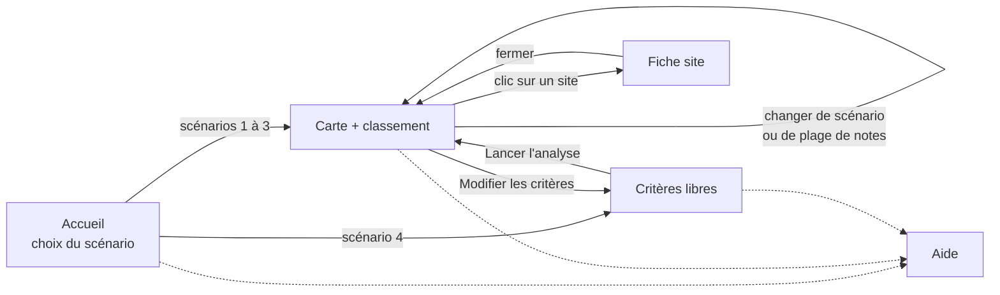

# Parcours utilisateur et maquettes

Maquette cliquable : [maquettes/index.html](maquettes/index.html) (à ouvrir dans un navigateur). Les valeurs des sites sont **fictives** ; les scénarios, paramètres et intervalles viennent de [scenarios.md](scenarios.md). Le score est calculé avec la formule du README pour que le classement de la maquette soit cohérent.

> **Vocabulaire** : dans l'interface, on parle de **scénario** (et non de « mode »). Les docs du repo et le contrat d'API disent encore « mode » : à aligner avec l'équipe.

## Éléments propres à la maquette (à ne pas développer)

- **Annotations API** (case en haut à droite) : affiche, sur chaque bloc, la route qui l'alimente.
- **Aperçu mobile** (bouton en haut à droite) : affiche la maquette dans un cadre de téléphone. La mise en page mobile repose sur des *container queries*, donc elle s'applique aussi bien dans ce cadre que sur un vrai téléphone.
- **État démo** (écran Carte) : simule les états chargement, erreur de source et aucun résultat.

## Site lunaire de référence et globes 3D

L'application n'est plus limitée au pôle Sud : l'utilisateur choisit un **site lunaire de référence** parmi 14 sites (pôles, mers, puits de tubes de lave, zones volcaniques, face cachée).

- **Choix** : dans une liste avec recherche (nom, région, mission, type ; flèches + Entrée au clavier), ou en **cliquant un point sur la Lune en 3D** (accueil ou écran Explorer). Les étiquettes se masquent derrière le globe et quand elles se chevauchent.
- **Fiche du site lunaire** : type, coordonnées, intérêt du site, pente, relief, temps éclairé, températures du sol au soleil et à l'ombre, glace d'eau, missions, et ce que l'application cherche sur Terre pour ce site. Bouton « Voir les analogues terrestres ».
- **Globes** : la carte plate est remplacée par une Terre en 3D (continents, atmosphère, points colorés par note). Vues **Lune**, **Côte à côte** (par défaut) et **Terre**. Glisser pour tourner, molette ou pincement pour zoomer, rotation lente au repos, recentrage animé sur le site choisi.
- **Scénarios génériques** : certains critères suivent le site lunaire choisi (pente et relief du scénario 1, latitude du scénario 3 seulement pour un site polaire, volcanisme renforcé pour une mer ou un tube de lave). Ces critères portent la mention « adapté » dans la fiche d'un site terrestre. **Règle proposée, à valider par Ouassim et David** : le README prévoit un seul profil de référence (`data/reference/moon-south-pole.json`) ; il en faudrait un par site lunaire.
- Coordonnées des sites lunaires réelles ; caractéristiques **indicatives**, à remplacer par LOLA, Diviner et LEND.

Interfaces dont la maquette reprend les principes (sans en copier l'apparence) :
- NASA Eyes on the Solar System : globe 3D cliquable et panneau d'information du lieu choisi.
- NASA Moon Trek et LROC QuickMap : recherche de lieux lunaires par nom.
- Google Earth : recentrage animé sur le lieu choisi, étiquettes qui suivent le globe.

## Parcours

1. **Accueil** : titre, Lune avec le pôle Sud ciblé, bandeau de données (cible, nombre de sites, paramètres, sources), 4 cartes de scénario, renvoi vers les limites de l'analogie.
2. **Carte** : liste classée à gauche, carte à droite (couleur = note). Au lancement d'un scénario, un court état de chargement précède les résultats. En scénario 2, choix des instruments à calibrer.
   - **Plage de compatibilité** : double curseur (pas de 5) et raccourcis *Toutes*, *Très proches · 70+*, *Partielles · 40–69*, *Faibles · <40*. La liste et la carte n'affichent que les sites dans la plage ; un compteur indique « X sites sur Y ».
   - Les sites exclus par le filtre végétation restent visibles, en fin de liste et en gris.
   - Survoler une ligne met en évidence le point sur la carte ; cliquer centre la carte sur le site (animation) et ouvre la fiche.
3. **Fiche site** : jauge de note animée, usage possible, « correspond » (critère ≥ 0,7) et « ne correspond pas » (< 0,4), barre par critère. **Survoler ou toucher un critère** affiche une bulle : description, équivalent lunaire, source de la donnée. Rappel de ce que la Terre ne reproduit pas.
4. **Critères libres (scénario 4)** : paramètres regroupés en 5 thèmes repliables (relief, températures, atmosphère et climat, énergie et position, géologie), avec *Tout déplier / Tout replier*. Chaque thème indique combien de paramètres sont actifs ; seuls les thèmes qui en contiennent sont dépliés à l'ouverture.
   - Chaque paramètre est une carte avec un interrupteur. Un **double curseur** fixe l'intervalle souhaité ; une poignée laissée en butée signifie « sans minimum » ou « sans maximum ». La **marge** apparaît en hachures de part et d'autre de l'intervalle.
   - Sous le curseur, un point par site candidat ; il passe au vert quand le site entre dans l'intervalle (« 4 sites sur 11 dedans »).
   - **Importance** en 3 niveaux (faible, moyenne, forte), choisie par boutons à barres.
   - Échelle logarithmique pour les séismes, la distance au volcan et le relief accidenté, pour régler finement les petites valeurs.
   - Barre collante en bas : nombre de critères actifs, aperçu en direct des 3 meilleurs sites, bouton *Lancer l'analyse*.
   - On peut partir des réglages d'un scénario 1 à 3. Filtre végétation coché par défaut.
5. **Aide** : sommaire fixe qui suit la lecture (grille de 6 boutons sur mobile, sans défilement).
   - *Prise en main* : les 4 étapes du parcours.
   - *Les scénarios* : question, public visé et critères de chaque scénario.
   - *Calcul de similarité* : filtre végétation, note par critère (courbe interactive avec un curseur), moyenne pondérée (formule et exemple chiffré du cratère Haughton), seuils de lecture.
   - *Les critères* : les 18 paramètres regroupés par famille (relief, températures, atmosphère et climat, énergie et position, géologie, surface), avec description, équivalent lunaire, source et scénarios qui les utilisent.
   - *Limites de l'analogie*.
   - *Glossaire* : 25 termes, avec recherche.

États prévus : **chargement** (avec l'état de chaque source), **erreur de source** (réessayer ou continuer sans elle), **aucun résultat** (élargir la plage ou modifier les critères). Sur mobile, la navigation passe dans une barre d'onglets en bas, la carte passe au-dessus de la liste et la fiche s'ouvre en plein écran.

## Données attendues de l'API par écran

| Écran | Route | Champs utilisés |
|---|---|---|
| Accueil | `GET /api/modes` (à renommer `/api/scenarios` ?) | `id`, `name`, `question`, `audience` (public visé) |
| Accueil, Explorer | `GET /api/reference/moon` | liste des sites lunaires : `id`, `name`, `region`, `lat`, `lon`, `kind` |
| Fiche lunaire | `GET /api/reference/moon/{id}` | `slope`, `roughness`, `illumination`, `tempDay`, `tempNight`, `ice`, `missions`, `description` |
| Explorer | `POST /api/analyze` | entrée supplémentaire : `moonSite` (id du site lunaire de référence) |
| Carte | `POST /api/analyze` | par site : `id`, `name`, `region`, `lat`, `lon`, `kind` (`known` / `control` / `new`), `score` (0-100), `excluded` (bool), `criteria[]` |
| Fiche | `POST /api/analyze` ou `GET /api/sites/{id}` | par critère : `param`, `group` (instrument ou besoin), `value`, `min`, `max`, `tolerance`, `weight`, `score` (0-1) ; `usage` (texte) |
| Fiche (bulles), Mode 4, Aide | `GET /api/parameters` | `id`, `label`, `help`, `unit`, `min`, `max`, `family`, `source`, `moonEquivalent` |
| Chargement / erreur | `POST /api/analyze` | statut par source en cas d'échec partiel (`sources[]: { name, status }`), pour afficher « continuer sans MODIS » |

Le filtre par plage de notes se fait côté front, sur les résultats déjà reçus : aucun paramètre d'API n'est nécessaire.

## À valider avec Jesus et François-Xavier avant le gel du contrat (sam 17 h 30)

- [ ] Terme « scénario » dans l'API (`scenario`, `/api/scenarios`) ou seulement dans l'interface ?
- [ ] `label`, `help`, `family`, `source`, `moonEquivalent` servis par `/api/parameters`, ou fichier de textes côté front ?
- [ ] `kind` du site (analogue connu, témoin, peu étudié) fourni par `data/candidates.json` et renvoyé par l'API.
- [ ] `excluded` renvoyé par `/api/analyze` plutôt que de retirer les sites végétalisés (le témoin Amazonie doit rester visible).
- [ ] `group` sur chaque critère (instrument au scénario 2, besoin au scénario 3).
- [ ] Échec partiel d'une source : erreur globale, ou résultats avec la liste des sources en échec ?
- [ ] Le texte « usage possible » est-il produit par l'API ou par le front ?
