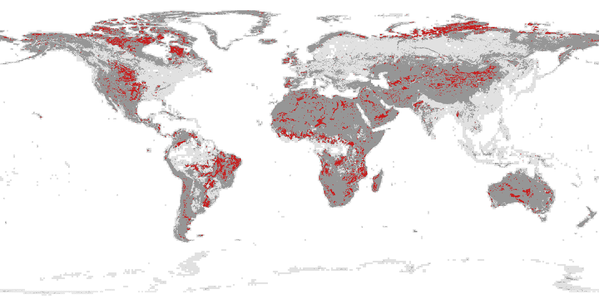
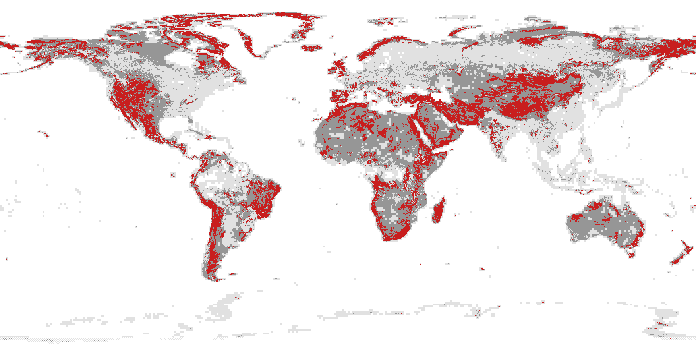
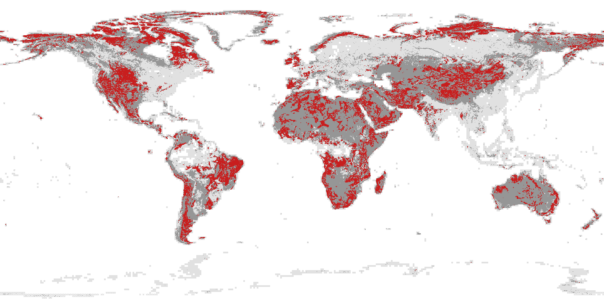

# run-001: first global discovery run, topography (T43, 18-19/11/2026)

Scenarios A (lunar base) and B (lunar robotics), slope only, validated with `validation-protocol-v2`.
- **Code:** the Earth cubes were computed with code version `fd46018b…` (commits `validation-protocol-v2` and `f802d03`); the analysis code is at the merge commit of T43.
- **Data:** outputs in `earthmoon-data/run001/` (not in git, SHA-256 in `data/runs/run-001/outputs.json`); summaries in `data/runs/run-001/`.

## Unfavourable results first

1. **No positive validation for A and B.** No verified reference names an analog site for these scenarios (protocol table). The results say where Earth slopes resemble lunar slopes. They do not show that a place is a good analog for a team.
2. **The top of the ranking is mostly artefacts.** Of the 40 dossiers (top 20 zones of A and of B), 38 are explained artefacts:
   - 23 are **remnants between hidden ground**: at least 20% of the zone's windows are masked, and the compared windows lie between fields, forest, water or buildings;
   - 15 are **tile-edge fragments**: 5 km cells cut by the edges of the 1° processing tiles keep a few windows each, and three such fragments make a "zone".
   One place is plausible, found for both scenarios (below). The ranking rule (median typicality, then area) was fixed before the run and is kept. Two rules are proposed for run-002 (protocol v3), applied everywhere:
   - rank zones on high-confidence cells only;
   - merge the parts of a cell cut by tile edges before computing its statistics.
3. **The ranking is not robust to the source or the scale** (top 100 zones of each scenario):

| Recomputed with | Scenario | Spearman of zone values | Top 20 kept |
|---|---|---|---|
| NASADEM instead of Copernicus | A | 0.48 | 40% |
| NASADEM instead of Copernicus | B | 0.54 | 45% |
| GLO-30 at 30 m instead of the lunar pixel | A | 0.30 | 35% |
| GLO-30 at 30 m instead of the lunar pixel | B | 0.42 | 40% |

   The protocol sets no threshold for these checks. With the artefacts above, they say that the zone list of run-001 must not be read as a ranking of places.
4. **Masks check: 17 of 18 negatives masked (pass needs 18).** The failing point is tree cover in the Paraguayan Chaco (24.74°S 59.81°W). Its 1 km window is 41% hidden, a forest-savanna mosaic below the 50% rule.
5. **Self-consistency fails for pits:** KS 0.056 (pass ≤ 0.05) on 135 held-out sites, a sample too small for a stable test. The other four targets pass.
6. **Under protocol v1 the masks check had failed badly:** 10 of 18 on the pilot tiles, because the engine masked 4 of the 7 hidden-ground classes. This was fixed before run-001 as protocol v2 (decided by David on 18/11, reasons in `docs/VALIDATION_PROTOCOL.md`).
7. **τ = 0.5 is loose.** Candidate zones cover 2.6 to 10.4 million km² per target. At τ = 0.9 and 9 cells, 6 to 76 zones remain for the polar targets, 15 for pits, and none for mare plains.

## What was computed

| Step | Result |
|---|---|
| Global 90 m cube (7 mask classes) | 26,475 tiles, 1.12 h, 0 failures |
| Screening (lunar IQR + 2°, unmasked windows, rock south of 60°S) | 16,520 tiles refined at 40 m, 18,363 at 59.2 m; dropped: 6,172 tiles south of 60°S without rock, 1,781 fully masked or empty tiles |
| Copernicus GLO-30 download (96 parallel connections) | 20,677 files, 545 GB, 3.0 h, 50 MB/s |
| Fine stages from the local copy | 40 m: 16,496 tiles, 4,700 tiles/h; 59.2 m: 18,338 tiles, 8,200 tiles/h; 0 failures |
| Assessment | 6,713,044 cells of 5 km, 0.43 h, 0 failures |

Coverage of the assessed cells:
- 53% have at least half of their windows hidden (forest, cropland, buildings, water, wetland, mangroves, snow or ice);
- confidence is high for 28.6%, medium for 12.9%, low for 58.6%.

This is what the coverage overlay of the interface (spec of 19/11) has to show first.

## Zones

Candidate cells: median typicality ≥ τ, not eliminated (B: Apollo LRV limit), fewer than half of their windows masked. A zone needs at least 3 connected cells.

| Scenario, target | Zones (τ 0.5, 3 cells) | Area | τ 0.7, 3 cells | τ 0.9, 3 cells | τ 0.9, 9 cells | Stable in Monte Carlo |
|---|---|---|---|---|---|---|
| A, polar lit highlands | 14,200 | 6.0 M km² | 8,251 | 82 | 6 | 9,975 |
| A, permanently shadowed regions | 13,242 | 10.4 M km² | 13,007 | 865 | 76 | 2,915 |
| A, pits | 16,812 | 9.0 M km² | 11,011 | 141 | 15 | 2,486 |
| B, polar lit highlands | 14,200 | 6.0 M km² | 8,251 | 82 | 6 | 9,975 |
| B, permanently shadowed regions | 13,238 | 10.4 M km² | 13,007 | 865 | 76 | 2,918 |
| B, mare plains | 8,970 | 2.6 M km² | 1,735 | 0 | 0 | 7,062 |
| B, south polar cap | 14,188 | 6.1 M km² | 8,311 | 81 | 6 | 10,007 |

**"Stable"** counts the zones whose median stays at or above the 90th percentile of a random sample of 200,000 evaluated cells in at least 90% of 500 runs (0.5° slope noise, seeds in `validation.json`). The test separates little: zones are, by construction, groups of typical cells, and the sample holds every evaluated cell.

Maps (grey: evaluated; light grey: hidden or mostly masked; red: cells of a zone; white: sea or screened out at 90 m):

| | |
|---|---|
|  A, lit highlands |  B, mare plains |
|  A, shadowed regions |  A, pits |

The other maps are in `run-001/`.

## Unexpected candidates (dossiers)

The 20 best zones of each scenario. No control list exists for A and B, so every zone is "unexpected". Outcomes follow a rule committed before any dossier was written (`tools/discovery/dossier.outcome`): tile-edge fragments, then remnants between hidden ground, then literature. One dossier per zone in `run-001/zones/`.

| Outcome | A | B |
|---|---|---|
| Explained artefact: remnants between hidden ground | 12 | 11 |
| Explained artefact: tile-edge fragments | 7 | 8 |
| Plausible | 1 | 1 |

**The plausible place:** Northern Territory, Australia (24.07°S 134.01°E), for lit highlands and the polar cap.
- Median typicality 0.95, in the top decile in 100% of Monte Carlo runs, no masked window.
- It is small (3 cells, 35 km²) and only just above the fragment rule (11.7 windows per cell).
- The literature describes quartzite and sandstone ridges of the MacDonnell Ranges nearby. That the zone lies in the East MacDonnell Ranges is my inference, not stated by the sources, and the match is my judgement.

Literature searches were run for the 6 places the data alone did not settle, or that were not obvious artefacts; queries and sources are in `data/runs/run-001/literature.json`. The other zones are classed by the data alone, as their dossiers say.

## Validation (protocol v2)

| Check | Rule | Result | Pass |
|---|---|---|---|
| Positives | median ≥ 75th percentile | none exist for A and B | no validation |
| Negatives in the top 10% | at most 1 of 18 per target | 0 for every target | yes |
| Masks | 18 of 18 masked or flagged | 17 of 18 | **no** |
| Self-consistency | KS ≤ 0.05 | polar cap 0.0049, lit highlands 0.0049, PSR 0.0236, mare 0.0008, pits 0.056 | 4 of 5 |
| Reproducibility | identical SHA-256 on rebuild | 5 of 5 tiles rebuilt from the source: identical files and identical cell rows | yes |

**Bias:**
- **By latitude:** candidates follow the evaluated land; there are fewer at the equator (forest masks) and more at 20 to 50°N and 60 to 80°N.
- **By continent** (Natural Earth): every continent has candidates. Antarctica has 205 candidate cells for shadowed regions (rock outcrops) and none for mare plains.
- Tables are in `data/runs/run-001/validation.json`.

## Fixed during the run

None of these changed a rule or a threshold:
- a download race between the two fine stages (one tile);
- the assessment ran out of memory (rows kept as Python objects);
- 17 tiles read v1 files at a scale the v2 screening had dropped;
- the zone, map and Monte Carlo steps were rewritten for speed and memory, with tests that the results are equal;
- the Docker engine stopped twice when two Monte Carlo targets ran together.

## What this run cannot show

- That a zone is a good analog for a team (only a field campaign can).
- Anything but slope (geology T46, thermal T47).
- Relief below the DEM pixel.
- Places where the ground is hidden (53% of the assessed cells).
