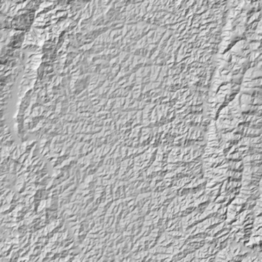

# Zone A-10: Serro, Minas Gerais, Região Sudeste, Brasil

run-001, scenario A, target `moon-psr`.

**Outcome: explained artefact.** Remnants between hidden ground: the compared windows lie between masked fields, forest, water or buildings.

| Value | |
|---|---|
| Centre | -18.6329, -43.2920 |
| Cells, area | 9 cells, 225 km² |
| Median typicality (median of cell medians) | 0.924 (cells: p25 0.728, p75 0.931) |
| Windows: all, compared (unmasked) | 225, 162 (mean masked share 0.28) |
| Windows per cell | 25.0 (a full 5 km cell has about 25) |
| High-confidence cells | 0% |
| Monte Carlo: runs in the sample's top decile | 100% |

Relief only (hillshade of the Copernicus DEM): no optical imagery is used.

## Literature

- Query: `Carbonita Serro Espinhaço Minas Gerais quartzite ridges relief geology`
- Finding: Southern Espinhaço Range: quartzitic sequences of the Espinhaço Supergroup; no source describes the relief of these exact zones.
- Sources: <https://revistas.ufvjm.edu.br/revista-espinhaco/article/download/860/692/2620>, <https://orbi.uliege.be/bitstream/2268/164508/1/Quartzite%20karsts%20in%20Brazil.pdf>
