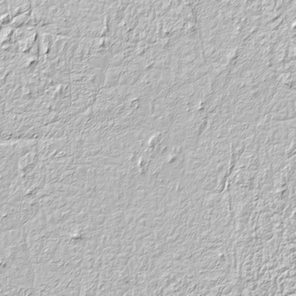

# Zone A-19: Haut-Uele, République démocratique du Congo

run-001, scenario A, target `moon-pits`.

**Outcome: explained artefact.** Remnants between hidden ground: the compared windows lie between masked fields, forest, water or buildings.

| Value | |
|---|---|
| Centre | 2.6074, 29.2808 |
| Cells, area | 8 cells, 200 km² |
| Median typicality (median of cell medians) | 0.917 (cells: p25 0.839, p75 0.936) |
| Windows: all, compared (unmasked) | 200, 119 (mean masked share 0.41) |
| Windows per cell | 25.0 (a full 5 km cell has about 25) |
| High-confidence cells | 0% |
| Monte Carlo: runs in the sample's top decile | 100% |

Relief only (hillshade of the Copernicus DEM): no optical imagery is used.

## Literature

- No search: the outcome follows from the data alone (rule above).
