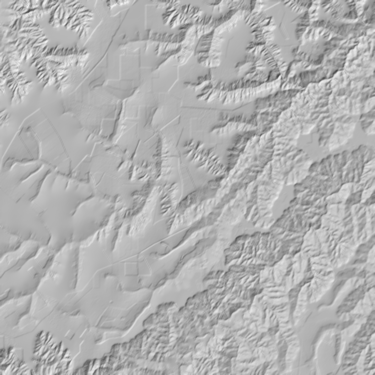

# Zone B-01: Carbonita, Minas Gerais, Região Sudeste, 39665-000, Brasil

run-001, scenario B, target `moon-psr`.

**Outcome: explained artefact.** Remnants between hidden ground: the compared windows lie between masked fields, forest, water or buildings.

| Value | |
|---|---|
| Centre | -17.5221, -43.0558 |
| Cells, area | 3 cells, 65 km² |
| Median typicality (median of cell medians) | 0.961 (cells: p25 0.892, p75 0.963) |
| Windows: all, compared (unmasked) | 65, 37 (mean masked share 0.43) |
| Windows per cell | 21.7 (a full 5 km cell has about 25) |
| High-confidence cells | 0% |
| Monte Carlo: runs in the sample's top decile | 100% |

Relief only (hillshade of the Copernicus DEM): no optical imagery is used.

## Literature

- Query: `Carbonita Serro Espinhaço Minas Gerais quartzite ridges relief geology`
- Finding: Southern Espinhaço Range: quartzitic sequences of the Espinhaço Supergroup; no source describes the relief of these exact zones.
- Sources: <https://revistas.ufvjm.edu.br/revista-espinhaco/article/download/860/692/2620>, <https://orbi.uliege.be/bitstream/2268/164508/1/Quartzite%20karsts%20in%20Brazil.pdf>
