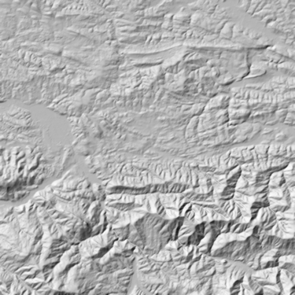

# Zone B-06: Lescure, Saint-Girons, Ariège, Occitanie, France métropolitaine, 09420, France

run-001, scenario B, target `moon-south-polar-cap-v2`, also found for `moon-polar-lit-highlands`.

**Outcome: explained artefact.** Tile-edge fragments: cells cut by the 1° tile edges keep a few windows each.

| Value | |
|---|---|
| Centre | 42.9997, 1.2282 |
| Cells, area | 6 cells, 26 km² |
| Median typicality (median of cell medians) | 0.930 (cells: p25 0.898, p75 0.940) |
| Windows: all, compared (unmasked) | 26, 20 (mean masked share 0.23) |
| Windows per cell | 4.3 (a full 5 km cell has about 25) |
| High-confidence cells | 0% |
| Monte Carlo: runs in the sample's top decile | 100% |

Relief only (hillshade of the Copernicus DEM): no optical imagery is used.

## Literature

- No search: the outcome follows from the data alone (rule above).
