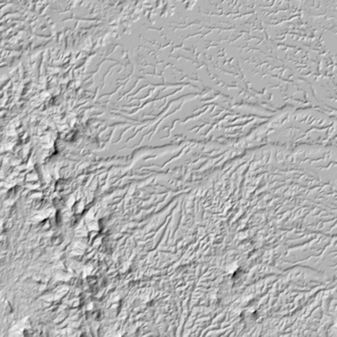

# Zone B-07: Itabela, Bahia, Região Nordeste, 45848-000, Brasil

run-001, scenario B, target `moon-psr`.

**Outcome: explained artefact.** Remnants between hidden ground: the compared windows lie between masked fields, forest, water or buildings.

| Value | |
|---|---|
| Centre | -16.7635, -39.5547 |
| Cells, area | 3 cells, 75 km² |
| Median typicality (median of cell medians) | 0.927 (cells: p25 0.873, p75 0.937) |
| Windows: all, compared (unmasked) | 75, 43 (mean masked share 0.43) |
| Windows per cell | 25.0 (a full 5 km cell has about 25) |
| High-confidence cells | 0% |
| Monte Carlo: runs in the sample's top decile | 100% |

Relief only (hillshade of the Copernicus DEM): no optical imagery is used.

## Literature

- No search: the outcome follows from the data alone (rule above).
