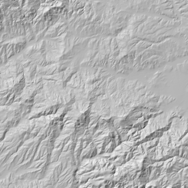

# Zone B-10: Sinanpaşa, Afyonkarahisar, Ege Bölgesi, Türkiye

run-001, scenario B, target `moon-psr`.

**Outcome: explained artefact.** Remnants between hidden ground: the compared windows lie between masked fields, forest, water or buildings.

| Value | |
|---|---|
| Centre | 38.7648, 30.0137 |
| Cells, area | 5 cells, 85 km² |
| Median typicality (median of cell medians) | 0.921 (cells: p25 0.903, p75 0.924) |
| Windows: all, compared (unmasked) | 85, 66 (mean masked share 0.23) |
| Windows per cell | 17.0 (a full 5 km cell has about 25) |
| High-confidence cells | 20% |
| Monte Carlo: runs in the sample's top decile | 100% |

Relief only (hillshade of the Copernicus DEM): no optical imagery is used.

## Literature

- Query: `Afyonkarahisar Sinanpaşa volcanic plateau geology relief`
- Finding: Neogene basin at about 1,115 m ringed by mountains, volcano-sedimentary fill; tuff plateaus and mesas nearby.
- Sources: <https://dergipark.org.tr/tr/pub/bulletinofmre/article/707988>, <https://acikbilim.yok.gov.tr/handle/20.500.12812/735880>
