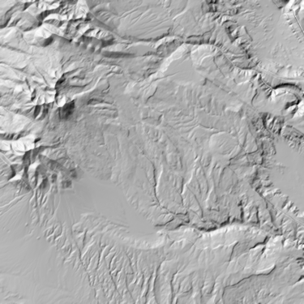

# Zone B-11: San Juan County, Utah, United States

run-001, scenario B, target `moon-psr`.

**Outcome: explained artefact.** Remnants between hidden ground: the compared windows lie between masked fields, forest, water or buildings.

| Value | |
|---|---|
| Centre | 38.3981, -109.1280 |
| Cells, area | 4 cells, 100 km² |
| Median typicality (median of cell medians) | 0.921 (cells: p25 0.853, p75 0.939) |
| Windows: all, compared (unmasked) | 100, 64 (mean masked share 0.36) |
| Windows per cell | 25.0 (a full 5 km cell has about 25) |
| High-confidence cells | 0% |
| Monte Carlo: runs in the sample's top decile | 100% |

Relief only (hillshade of the Copernicus DEM): no optical imagery is used.

## Literature

- Query: `San Juan County Utah 38.4N 109.1W canyons mesas Paradox Basin geology`
- Finding: Paradox Basin: canyons, mesas, buttes and hogbacks; the sources do not place a feature at these coordinates.
- Sources: <https://ugspub.nr.utah.gov/publications/public_information/pi-14.pdf>, <https://www.nps.gov/articles/nps-geodiversity-atlas-canyonlands-national-park.htm>
