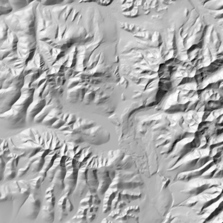

# Zone B-16: Тенькинский муниципальный округ, Магаданская область, Дальневосточный федеральный округ, 686050, Россия

run-001, scenario B, target `moon-psr`.

**Outcome: explained artefact.** Tile-edge fragments: cells cut by the 1° tile edges keep a few windows each.

| Value | |
|---|---|
| Centre | 62.1328, 148.9964 |
| Cells, area | 3 cells, 15 km² |
| Median typicality (median of cell medians) | 0.918 (cells: p25 0.845, p75 0.930) |
| Windows: all, compared (unmasked) | 15, 11 (mean masked share 0.27) |
| Windows per cell | 5.0 (a full 5 km cell has about 25) |
| High-confidence cells | 0% |
| Monte Carlo: runs in the sample's top decile | 100% |

Relief only (hillshade of the Copernicus DEM): no optical imagery is used.

## Literature

- No search: the outcome follows from the data alone (rule above).
