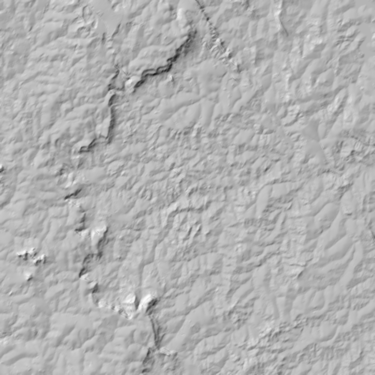

# Zone B-19: Cássia, Minas Gerais, Região Sudeste, 37980-000, Brasil

run-001, scenario B, target `moon-psr`.

**Outcome: explained artefact.** Remnants between hidden ground: the compared windows lie between masked fields, forest, water or buildings.

| Value | |
|---|---|
| Centre | -20.6303, -46.9911 |
| Cells, area | 5 cells, 65 km² |
| Median typicality (median of cell medians) | 0.916 (cells: p25 0.803, p75 0.920) |
| Windows: all, compared (unmasked) | 65, 50 (mean masked share 0.22) |
| Windows per cell | 13.0 (a full 5 km cell has about 25) |
| High-confidence cells | 0% |
| Monte Carlo: runs in the sample's top decile | 100% |

Relief only (hillshade of the Copernicus DEM): no optical imagery is used.

## Literature

- No search: the outcome follows from the data alone (rule above).
