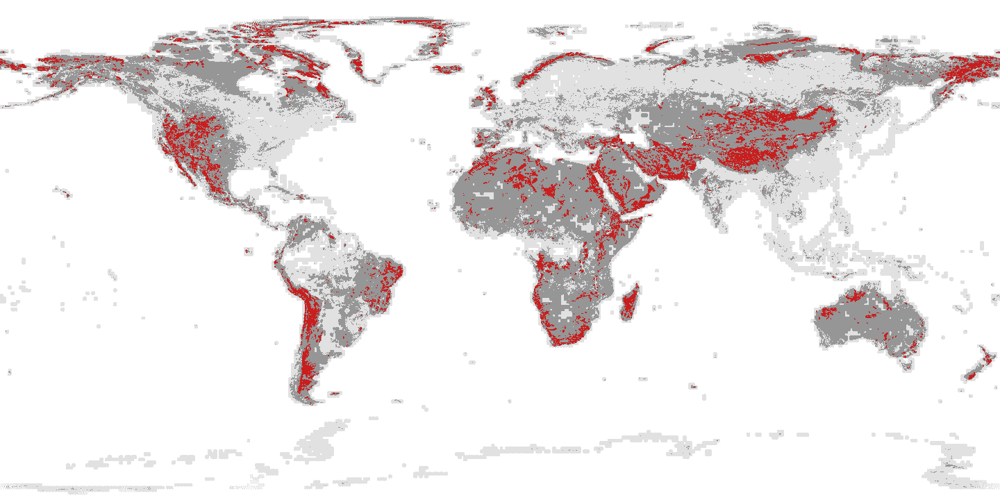
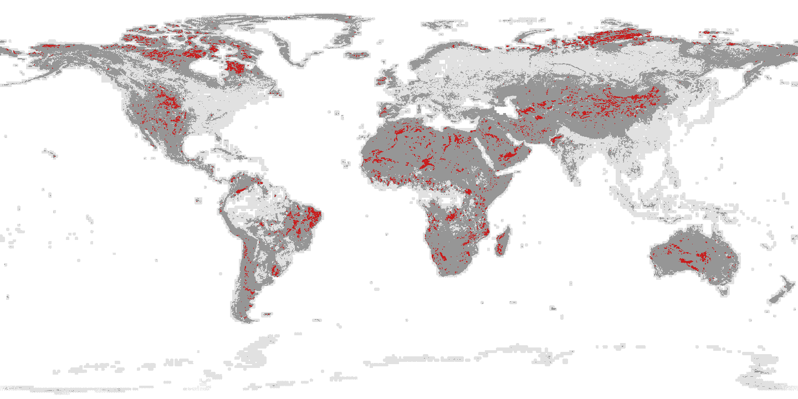
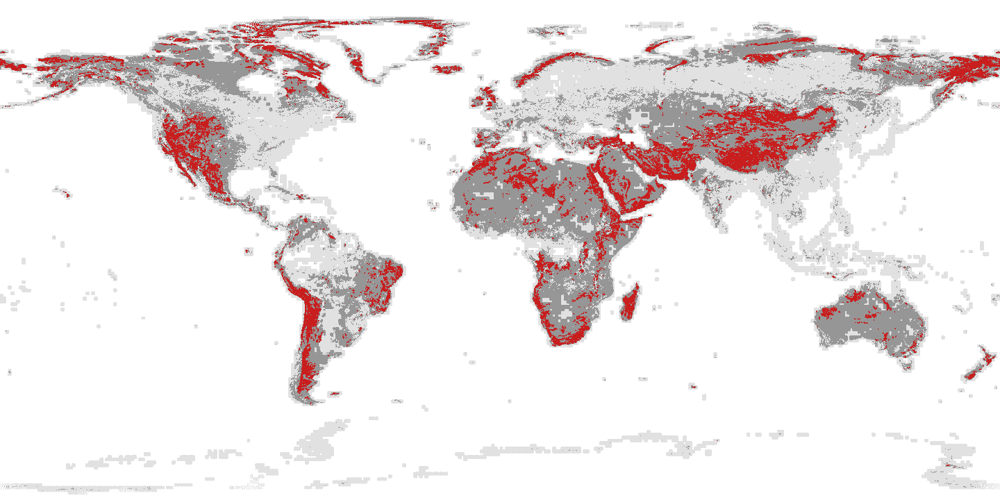
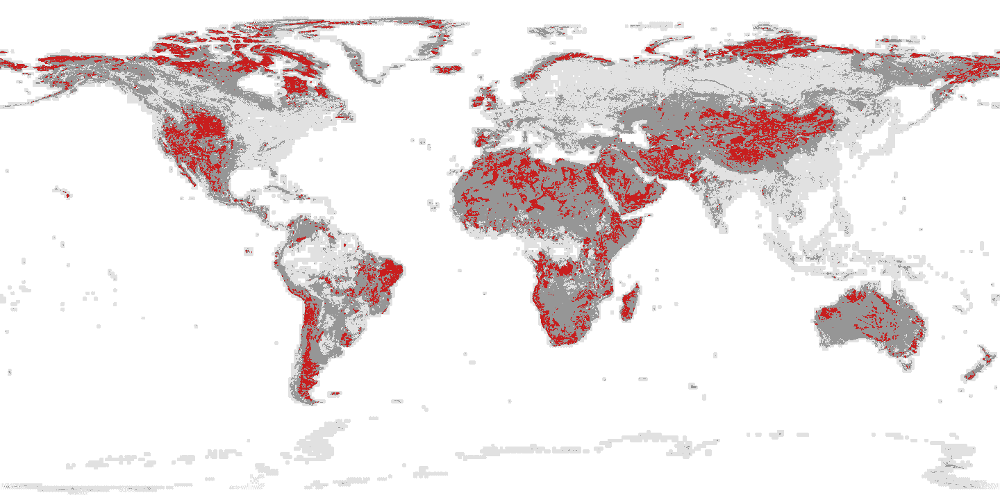

# run-002: global discovery run with protocol v3 (T43b, 19/11/2026)

Scenarios A (lunar base) and B (lunar robotics), slope only, validated with `validation-protocol-v3`. It applies the two rules that run-001 called for and David decided when signing G4 (19/11):
1. 5 km cells are cells of one global equal-area grid (HEALPix, NSIDE 1303, 25.04 km²). A cell cut by 1° tile edges is one cell with the windows of both tiles.
2. Candidate cells must have high confidence. Zones are made of, and ranked on, high-confidence cells only.

Unchanged from run-001: the windows (same cubes), the masks, τ, the minimum zone size, the controls and the pass thresholds.
- **Code:** analysis code at the merge commit of T43b (tag `validation-protocol-v3` for the rules).
- **Data:** outputs in `earthmoon-data/run002/` (not in git, SHA-256 in `data/runs/run-002/outputs.json`); summaries in `data/runs/run-002/`.

## Unfavourable results first

1. **Still no positive validation for A and B.** No verified reference names an analog site for these scenarios. The results say where Earth slopes resemble lunar slopes. They do not show that a place is a good analog for a team.
2. **The two artefacts are gone, but the top zones are not shown to be analogs.** Of the 40 dossiers (top 20 of A and of B, 23 distinct places), none is a tile-edge fragment (24.5 to 26.3 windows per cell) and none is a remnant between hidden ground (masked share 2 to 8%). The outcome rule then rests on the literature:
   - 2 places are plausible (4 dossiers): Andrelândia, Minas Gerais, and northern Skye, Scotland;
   - 21 places are unknown (36 dossiers): the searches found only regional descriptions, or nothing on the relief.
3. **The top is almost all one target.** 36 of the 40 dossiers are for permanently shadowed regions, 3 for pits, 1 for lit highlands. Zones of all targets are ranked together by median typicality, a rule fixed before run-001. PSR slopes (median 9.5°, wide spread) match common hilly land, so PSR zones reach the highest medians. Six of the 23 places are in one hilly region of southern Minas Gerais.
4. **The ranking is still not robust to the DEM source; it is more robust to the scale** (top 100 zones of each scenario, run-001 in brackets):

| Recomputed with | Scenario | Spearman of zone values | Top 20 kept |
|---|---|---|---|
| NASADEM instead of Copernicus | A | 0.08 (0.48) | 35% (40%) |
| NASADEM instead of Copernicus | B | 0.34 (0.54) | 45% (45%) |
| GLO-30 at 30 m instead of the lunar pixel | A | 0.55 (0.30) | 60% (35%) |
| GLO-30 at 30 m instead of the lunar pixel | B | 0.60 (0.42) | 65% (40%) |

   NASADEM covers 90 and 88 of the 100 zones (60°N to 56°S). The protocol sets no threshold for these checks. The top 100 zones lie close together in value (recomputed medians 0.83 to 0.94), so a small change of source reorders them: the zone list of run-002 must not be read as a ranking of places either.
5. **Masks check: 17 of 18, as in run-001.** The point in the Paraguayan Chaco (41% hidden) is unchanged: the rules do not touch the masks.
6. **Self-consistency still fails for pits:** KS 0.056 on 135 held-out sites, as in run-001 (the rules do not change the reference sets).
7. **A fix during the run:** the first run-002 assessment left 7.8% of cells without a confidence. Coverage and confidence were read at the coarsest scale of the tile, not the finest scale where the cell has windows. The run was stopped, the code fixed with a test (commit `a3247d0`) and the assessment rerun. No rule or threshold changed.

## What was computed

| Step | run-001 | run-002 |
|---|---|---|
| Cells | squares of each tile's projection | HEALPix cells of 25.04 km², one grid for the globe |
| Tiles read | 34,834 fine-stage tiles | the same tiles (18,478 refined, 24,436 read with their neighbours) |
| Assessed cells | 6,713,044 | 6,296,808, 0.48 h, 0 failures |
| Cells with fewer than 10 windows | 5.6% | 1.1% |
| Confidence high / medium / low | 28.6 / 12.9 / 58.6% | 31.1 / 12.7 / 56.2% |
| At least half the windows hidden | 53% | 53% |

## Zones

Candidate cells: median typicality ≥ τ, not eliminated (B: Apollo LRV limit), fewer than half of their windows masked, and (new) high confidence. A zone needs at least 3 connected cells (HEALPix neighbours).

| Scenario, target | Zones τ 0.5, 3 cells (run-001) | Area | τ 0.7, 3 cells | τ 0.9, 3 cells | τ 0.9, 9 cells | Stable in Monte Carlo (run-001) |
|---|---|---|---|---|---|---|
| A and B, polar lit highlands | 9,961 (14,200) | 4.0 M km² | 4,509 | 24 | 3 | 7,450, 75% (9,975, 70%) |
| A and B, permanently shadowed regions | 9,912 (13,242) | 7.1 M km² | 8,864 | 251 | 28 | 2,290, 23% (2,915, 22%) |
| A, pits | 12,290 (16,812) | 6.2 M km² | 7,199 | 62 | 9 | 1,955, 16% (2,486, 15%) |
| B, mare plains | 5,670 (8,970) | 1.6 M km² | 959 | 1 | 0 | 4,803, 85% (7,062, 79%) |
| B, south polar cap | 9,953 (14,188) | 4.0 M km² | 4,580 | 26 | 3 | 7,316, 74% (10,007, 71%) |

- There are about 30% fewer zones, and a larger share of them is stable for every target. That is the expected effect of rule 2.
- "Stable" has the meaning of run-001: the zone median stays at or above the 90th percentile of 200,000 sampled cells in at least 90% of 500 runs (0.5° slope noise, seeds in `validation.json`).
- A and B now give the same zones for shadowed regions and lit highlands: the LRV limit removes no high-confidence cell of these zones.

Maps (grey: evaluated; light grey: hidden or mostly masked; red: cells of a zone; white: sea or screened out at 90 m):

| | |
|---|---|
|  A, lit highlands |  B, mare plains |
|  A, shadowed regions |  A, pits |

The other maps are in `run-002/`.

## Unexpected candidates (dossiers)

The 20 best zones of each scenario, outcomes by the rule committed before run-001 (`tools/discovery/dossier.outcome`). Every place was searched (queries, findings and sources in `data/runs/run-002/literature.json`). A match needs a source on the place itself, or on an area that names it; a regional description is not enough, as in run-001. One dossier per zone in `run-002/zones/`.

| Outcome | A | B |
|---|---|---|
| Explained artefact | 0 | 0 |
| Plausible | 2 | 2 |
| Unknown | 18 | 18 |

**The plausible places:**
- **Andrelândia, Minas Gerais, Brazil** (21.75°S 44.29°W; A-09, B-08), shadowed regions. A thesis on the Andrelândia area describes "mar de morros" relief: hills cut by valleys at an advanced stage of dissection.
- **Northern Skye, Scotland** (57.42°N 6.65°W; A-18, B-15), shadowed regions. Gently dipping lava flows of 10 to 15 m give northern Skye a stepped "trap" landscape.

Both are small (3 cells, 75 km²), fully high-confidence, and in the top decile in 100% of Monte Carlo runs. That the described relief matches the PSR slope profile is my judgement.

**Not settled:** pits zone A-17 (Santana, Amapá, Brazil) lies in the Amazon estuary lowlands. The literature describes flat floodplains and a dissected low plateau there, without saying which holds the zone.

## Validation (protocol v3)

| Check | Rule | run-001 | run-002 | Pass |
|---|---|---|---|---|
| Positives | median ≥ 75th percentile | none exist | none exist | no validation |
| Negatives in the top 10% | at most 1 of 18 per target | 0 | 0 for every target | yes |
| Masks | 18 of 18 masked or flagged | 17 of 18 | 17 of 18 | **no** |
| Self-consistency | KS ≤ 0.05 | 4 of 5 | 4 of 5 (pits 0.056) | partly |
| Reproducibility | identical SHA-256 on rebuild | 5 of 5 | 5 of 5 tiles, identical cell rows | yes |

**Bias:**
- **By latitude:** as in run-001, candidates follow the evaluated land; they are fewer at the equator (forest masks).
- **By continent** (Natural Earth): every continent has candidates, except Antarctica for mare plains. Antarctic candidates drop with rule 2: 35 cells for shadowed regions (run-001: 205), 16 for lit highlands (101), 5 for pits (25).
- Tables are in `data/runs/run-002/validation.json`.

## What this run cannot show

- That a zone is a good analog for a team (only a field campaign can).
- Anything but slope (geology T46, thermal T47).
- Relief below the DEM pixel.
- Places where the ground is hidden (53% of the assessed cells).
