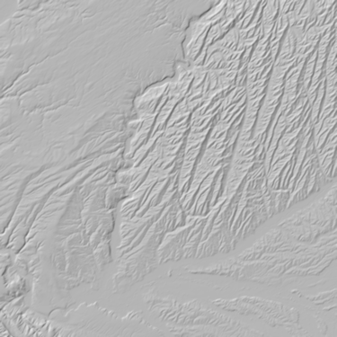

# Zone A-01: Walla Walla County, Washington, United States

run-002, scenario A, target `moon-psr`.

**Outcome: unknown.** No literature found on the relief of this place.

| Value | |
|---|---|
| Centre | 46.1404, -118.6032 |
| Cells, area | 3 cells, 75 km² |
| Median typicality (median of cell medians) | 0.940 (cells: p25 0.870, p75 0.947) |
| Windows: all, compared (unmasked) | 76, 71 (mean masked share 0.07) |
| Windows per cell | 25.3 (a full 5 km cell has about 25) |
| High-confidence cells | 100% |
| Monte Carlo: runs in the sample's top decile | 100% |

Relief only (hillshade of the Copernicus DEM): no optical imagery is used.

## Literature

- Query: `Walla Walla County Touchet Blue Mountains foothills terrain canyons slopes geology`
- Finding: Walla Walla basin between the Blue Mountains and the Columbia Plateau: canyons in the mountains, alluvial fans and terraces below, rolling lower reaches. No source describes the zone itself.
- Sources: <https://www.usgs.gov/index.php/publications/geology-and-ground-water-resources-walla-walla-river-basin-washington-oregon>, <https://www.oregonencyclopedia.org/articles/walla-walla-river/>
