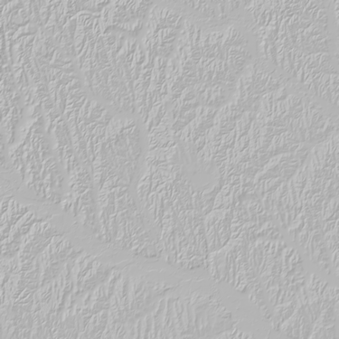

# Zone A-04: Custer County, Nebraska, United States

run-002, scenario A, target `moon-pits`.

**Outcome: unknown.** No literature found on the relief of this place.

| Value | |
|---|---|
| Centre | 41.1063, -99.3246 |
| Cells, area | 4 cells, 100 km² |
| Median typicality (median of cell medians) | 0.919 (cells: p25 0.911, p75 0.924) |
| Windows: all, compared (unmasked) | 100, 94 (mean masked share 0.06) |
| Windows per cell | 25.0 (a full 5 km cell has about 25) |
| High-confidence cells | 100% |
| Monte Carlo: runs in the sample's top decile | 100% |

Relief only (hillshade of the Copernicus DEM): no optical imagery is used.

## Literature

- Query: `Custer County Nebraska loess canyons terrain Middle Loup dissected hills`
- Finding: Central Nebraska Loess Hills, cut by the Loup rivers; the steepest ecological site (Loess Breaks) has slopes above 30%. The pits profile is gentle (median 3.7°): the description does not match it.
- Sources: <https://edit.sc.egov.usda.gov/catalogs/esd/071X/R071XY042NE>
