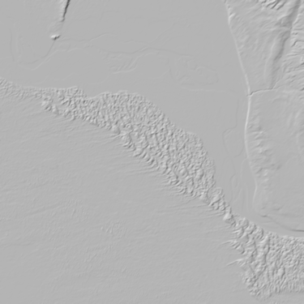

# Zone A-05: ولسوالی کلدار, ولایت بلخ, افغانستان

run-002, scenario A, target `moon-psr`.

**Outcome: unknown.** No literature found on the relief of this place.

| Value | |
|---|---|
| Centre | 37.1379, 67.6900 |
| Cells, area | 3 cells, 75 km² |
| Median typicality (median of cell medians) | 0.918 (cells: p25 0.748, p75 0.933) |
| Windows: all, compared (unmasked) | 74, 72 (mean masked share 0.03) |
| Windows per cell | 24.7 (a full 5 km cell has about 25) |
| High-confidence cells | 100% |
| Monte Carlo: runs in the sample's top decile | 100% |

Relief only (hillshade of the Copernicus DEM): no optical imagery is used.

## Literature

- Query: `Kaldar district Balkh Afghanistan terrain sand dunes Amu Darya relief`
- Finding: District on the Amu Darya floodplain; north Afghanistan has sand drifts, dunes and loess in general. Nothing on the relief of the zone.
- Sources: <https://en.wikipedia.org/wiki/Kaldar_District>
