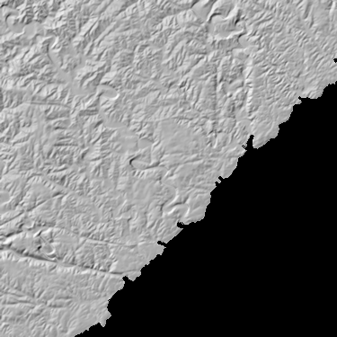

# Zone A-06: Mbhashe Local Municipality, Amathole District Municipality, Eastern Cape, South Africa

run-002, scenario A, target `moon-psr`.

**Outcome: unknown.** No literature found on the relief of this place.

| Value | |
|---|---|
| Centre | -32.3558, 28.7107 |
| Cells, area | 3 cells, 75 km² |
| Median typicality (median of cell medians) | 0.916 (cells: p25 0.890, p75 0.923) |
| Windows: all, compared (unmasked) | 74, 71 (mean masked share 0.04) |
| Windows per cell | 24.7 (a full 5 km cell has about 25) |
| High-confidence cells | 100% |
| Monte Carlo: runs in the sample's top decile | 100% |

Relief only (hillshade of the Copernicus DEM): no optical imagery is used.

## Literature

- Query: `Mbhashe Eastern Cape topography deeply incised valleys rolling hills Transkei relief`
- Finding: Former Transkei: rolling hills with deeply incised river valleys; the Mbhashe river crosses a plateau, then incised valleys. Regional, not the zone.
- Sources: <https://www.dws.gov.za/Documents/Other/WMA/12/MzimvubuMbasheISPFeb05Chap2.pdf>, <https://www.britannica.com/place/South-Africa/Relief>
