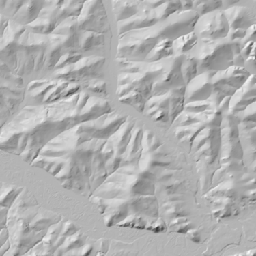

# Zone A-08: Пенжинский район, Камчатский край, Дальневосточный федеральный округ, Россия

run-002, scenario A, target `moon-psr`.

**Outcome: unknown.** No literature found on the relief of this place.

| Value | |
|---|---|
| Centre | 64.0359, 166.1297 |
| Cells, area | 5 cells, 125 km² |
| Median typicality (median of cell medians) | 0.913 (cells: p25 0.891, p75 0.916) |
| Windows: all, compared (unmasked) | 128, 124 (mean masked share 0.03) |
| Windows per cell | 25.6 (a full 5 km cell has about 25) |
| High-confidence cells | 100% |
| Monte Carlo: runs in the sample's top decile | 100% |

Relief only (hillshade of the Copernicus DEM): no optical imagery is used.

## Literature

- Query: `Penzhinsky district Kamchatka 64°N 166°E relief mountains Penzhina river topography`
- Finding: District between the Penzhina range and the Parapolsky Dol plain; no relief description of the zone.
- Sources: <https://en.wikipedia.org/wiki/Penzhinsky_District>, <https://en.wikipedia.org/wiki/Penzhina>
