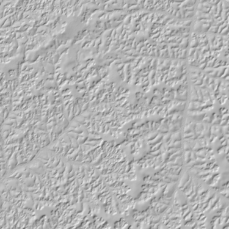

# Zone A-10: Kwilu, République démocratique du Congo

run-002, scenario A, target `moon-psr`.

**Outcome: unknown.** No literature found on the relief of this place.

| Value | |
|---|---|
| Centre | -4.4100, 18.8861 |
| Cells, area | 7 cells, 175 km² |
| Median typicality (median of cell medians) | 0.907 (cells: p25 0.872, p75 0.913) |
| Windows: all, compared (unmasked) | 175, 167 (mean masked share 0.05) |
| Windows per cell | 25.0 (a full 5 km cell has about 25) |
| High-confidence cells | 100% |
| Monte Carlo: runs in the sample's top decile | 100% |

Relief only (hillshade of the Copernicus DEM): no optical imagery is used.

## Literature

- Query: `Kwilu province DRC relief plateaux dissected valleys Kwango plateau topography`
- Finding: Kwango-Kwilu: plateaus cut by entrenched valleys with steep edges and landslides (regional studies, mostly student work). Nothing on the zone.
- Sources: <https://en.wikipedia.org/wiki/Kwilu_Province>, <https://ajol.info/index.php/rafea/article/view/257649/243351>
