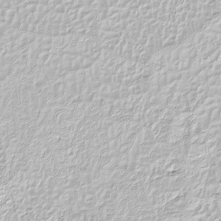

# Zone A-13: Bétaré-Oya, Lom-et-Djérem, Est, Cameroun

run-002, scenario A, target `moon-pits`.

**Outcome: unknown.** No literature found on the relief of this place.

| Value | |
|---|---|
| Centre | 5.1860, 14.4129 |
| Cells, area | 3 cells, 75 km² |
| Median typicality (median of cell medians) | 0.904 (cells: p25 0.873, p75 0.906) |
| Windows: all, compared (unmasked) | 76, 73 (mean masked share 0.04) |
| Windows per cell | 25.3 (a full 5 km cell has about 25) |
| High-confidence cells | 100% |
| Monte Carlo: runs in the sample's top decile | 100% |

Relief only (hillshade of the Copernicus DEM): no optical imagery is used.

## Literature

- Query: `Bétaré-Oya Cameroun relief géomorphologie collines Lom`
- Finding: Old ORSTOM geology: the Lom valley is the only notable relief, with schist hills along a mining track. Does not describe the pits profile (gentle slopes) or the zone.
- Sources: <https://horizon.documentation.ird.fr/exl-doc/pleins_textes/pleins_textes_5/b_fdi_14-15/18031.pdf>
