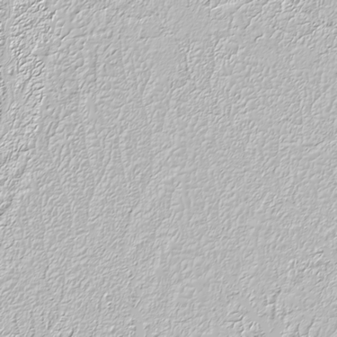

# Zone A-17: Santana, Amapá, Região Norte, Brasil

run-002, scenario A, target `moon-pits`.

**Outcome: unknown.** No literature found on the relief of this place.

| Value | |
|---|---|
| Centre | 0.2435, -51.4050 |
| Cells, area | 13 cells, 326 km² |
| Median typicality (median of cell medians) | 0.893 (cells: p25 0.871, p75 0.915) |
| Windows: all, compared (unmasked) | 325, 319 (mean masked share 0.02) |
| Windows per cell | 25.0 (a full 5 km cell has about 25) |
| High-confidence cells | 100% |
| Monte Carlo: runs in the sample's top decile | 100% |

Relief only (hillshade of the Copernicus DEM): no optical imagery is used.

## Literature

- Query: `Santana Amapá relief terrain floodplain Amazon estuary topography geology`
- Finding: Amapá lowlands: flat tidal floodplains toward the Amazon, and savannas on a dissected low plateau (0 to 55 m). Which setting holds the zone is not stated; its hillshade shows low, finely dissected relief.
- Sources: <https://www.scielo.br/j/bcg/a/TxPHtChhdBSrPHbf5GL9kDR/?lang=en>
