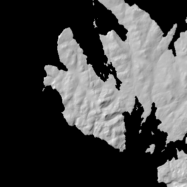

# Zone A-18: Highland, Alba / Scotland, United Kingdom

run-002, scenario A, target `moon-psr`.

**Outcome: plausible.** Relief described in the literature matches the measured slope distribution.

| Value | |
|---|---|
| Centre | 57.4175, -6.6512 |
| Cells, area | 3 cells, 75 km² |
| Median typicality (median of cell medians) | 0.892 (cells: p25 0.755, p75 0.901) |
| Windows: all, compared (unmasked) | 77, 71 (mean masked share 0.08) |
| Windows per cell | 25.7 (a full 5 km cell has about 25) |
| High-confidence cells | 100% |
| Monte Carlo: runs in the sample's top decile | 100% |

Relief only (hillshade of the Copernicus DEM): no optical imagery is used.

## Literature

- Query: `Waternish Dunvegan Skye stepped basalt lava plateau trap landscape terraces`
- Finding: Gently dipping Palaeogene lavas cover most of northern Skye and give a stepped 'trap' landscape (flows of 10 to 15 m).
- Sources: <https://nature.scot/doc/landscape-character-assessment-skye-and-lochalsh-landscape-evolution-and-influences>, <https://en.wikipedia.com/wiki/Geology_of_Skye>
