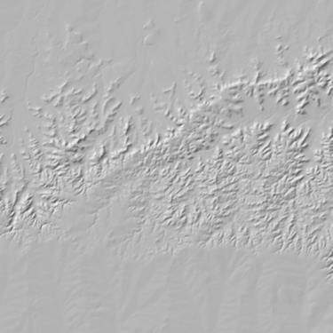

# Zone A-19: Beed, Maharashtra, 431122, India

run-002, scenario A, target `moon-psr`.

**Outcome: unknown.** No literature found on the relief of this place.

| Value | |
|---|---|
| Centre | 18.8970, 75.8749 |
| Cells, area | 3 cells, 75 km² |
| Median typicality (median of cell medians) | 0.892 (cells: p25 0.845, p75 0.902) |
| Windows: all, compared (unmasked) | 76, 70 (mean masked share 0.08) |
| Windows per cell | 25.3 (a full 5 km cell has about 25) |
| High-confidence cells | 100% |
| Monte Carlo: runs in the sample's top decile | 100% |

Relief only (hillshade of the Copernicus DEM): no optical imagery is used.

## Literature

- Query: `Beed district Maharashtra Deccan trap plateau Balaghat range hills relief slopes`
- Finding: Deccan basalt; district units are lowland, Godavari highland, Balaghat plateau (flat-topped hills) and Sina basin. Which unit holds the zone is not stated.
- Sources: <https://cgwb.gov.in/sites/default/files/2022-10/beed.pdf>, <https://en.wikipedia.org/wiki/Balaghat_Range>
