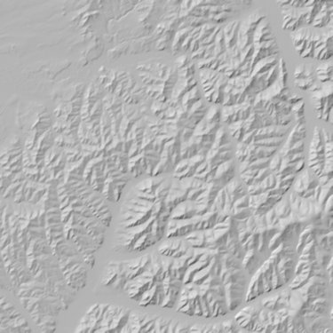

# Zone A-20: 罕达盖苏木, 新巴尔虎左旗, 呼伦贝尔市 ᠬᠥᠯᠥᠨ ᠪᠤᠶᠢᠷ, 内蒙古自治区 ᠦᠪᠦᠷ ᠮᠣᠩᠭᠤᠯ ᠤᠨ ᠥᠪᠡᠷᠲᠡᠭᠡᠨ ᠵᠠᠰᠠᠬᠣ ᠣᠷᠣᠨ, 中国

run-002, scenario A, target `moon-psr`.

**Outcome: unknown.** No literature found on the relief of this place.

| Value | |
|---|---|
| Centre | 47.6498, 119.5941 |
| Cells, area | 10 cells, 250 km² |
| Median typicality (median of cell medians) | 0.891 (cells: p25 0.807, p75 0.905) |
| Windows: all, compared (unmasked) | 253, 244 (mean masked share 0.04) |
| Windows per cell | 25.3 (a full 5 km cell has about 25) |
| High-confidence cells | 100% |
| Monte Carlo: runs in the sample's top decile | 100% |

Relief only (hillshade of the Copernicus DEM): no optical imagery is used.

## Literature

- Query: `New Barag Left Banner Handagai Greater Khingan foothills terrain hills relief`
- Finding: No relief description of Handagai; the region is grassland west of the Da Hinggan range.
- Sources: <https://en.wikipedia.org/wiki/New_Barag_Left_Banner>, <https://www.britannica.com/print/article/244001>
