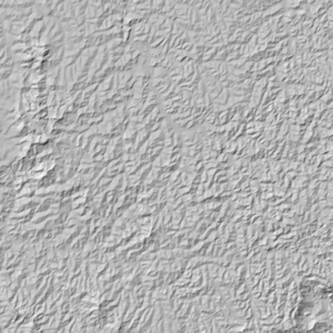

# Zone B-02: Ibertioga, Minas Gerais, Região Sudeste, 36225-000, Brasil

run-002, scenario B, target `moon-psr`.

**Outcome: unknown.** No literature found on the relief of this place.

| Value | |
|---|---|
| Centre | -21.4582, -43.9870 |
| Cells, area | 3 cells, 75 km² |
| Median typicality (median of cell medians) | 0.935 (cells: p25 0.914, p75 0.952) |
| Windows: all, compared (unmasked) | 74, 70 (mean masked share 0.05) |
| Windows per cell | 24.7 (a full 5 km cell has about 25) |
| High-confidence cells | 100% |
| Monte Carlo: runs in the sample's top decile | 100% |

Relief only (hillshade of the Copernicus DEM): no optical imagery is used.

## Literature

- Query: `Ibertioga São Tiago Andrelândia Minas Gerais relevo "mar de morros" serras quartzito`
- Finding: Only regional descriptions (Alto Rio Grande plateau: rounded hills, quartzite ridges above 1,400 m); nothing names these municipalities.
- Sources: <https://seer.ufu.br/index.php/caminhosdegeografia/article/download/16457/9195/61546>, <https://www.bdtd.uerj.br:8443/bitstream/1/7084/7/Parte%203%20F.pdf>
