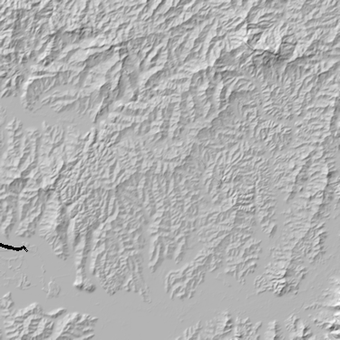

# Zone B-06: Boyacá, Chone, Manabí, Ecuador

run-002, scenario B, target `moon-psr`.

**Outcome: unknown.** No literature found on the relief of this place.

| Value | |
|---|---|
| Centre | -0.5912, -80.1746 |
| Cells, area | 6 cells, 150 km² |
| Median typicality (median of cell medians) | 0.914 (cells: p25 0.877, p75 0.931) |
| Windows: all, compared (unmasked) | 148, 140 (mean masked share 0.05) |
| Windows per cell | 24.7 (a full 5 km cell has about 25) |
| High-confidence cells | 100% |
| Monte Carlo: runs in the sample's top decile | 100% |

Relief only (hillshade of the Copernicus DEM): no optical imagery is used.

## Literature

- Query: `Chone Manabí Ecuador relieve colinas cordillera costera pendientes`
- Finding: Canton surrounded by hills and small coastal ranges above 100 m (source of variable quality). No slope data for the zone.
- Sources: <https://www.ecured.cu/Cantón_Chone>
