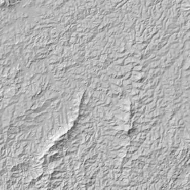

# Zone B-08: Andrelândia, Minas Gerais, Região Sudeste, 37300-000, Brasil

run-002, scenario B, target `moon-psr`.

**Outcome: plausible.** Relief described in the literature matches the measured slope distribution.

| Value | |
|---|---|
| Centre | -21.7525, -44.2863 |
| Cells, area | 3 cells, 75 km² |
| Median typicality (median of cell medians) | 0.913 (cells: p25 0.912, p75 0.921) |
| Windows: all, compared (unmasked) | 79, 76 (mean masked share 0.04) |
| Windows per cell | 26.3 (a full 5 km cell has about 25) |
| High-confidence cells | 100% |
| Monte Carlo: runs in the sample's top decile | 100% |

Relief only (hillshade of the Copernicus DEM): no optical imagery is used.

## Literature

- Query: `Ibertioga São Tiago Andrelândia Minas Gerais relevo "mar de morros" serras quartzito`
- Finding: A thesis on the Andrelândia area: predominant 'mar de morros' relief, an advanced stage of dissection with hills cut by valleys; Andrelândia Group quartzites give cuesta relief.
- Sources: <https://www.bdtd.uerj.br:8443/bitstream/1/7084/7/Parte%203%20F.pdf>, <https://seer.ufu.br/index.php/caminhosdegeografia/article/download/16457/9195/61546>
