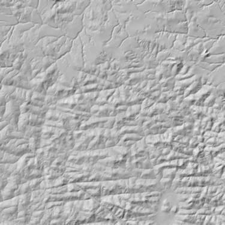

# Zone B-10: Lafaiete Coutinho, Bahia, Região Nordeste, 45215-000, Brasil

run-002, scenario B, target `moon-psr`.

**Outcome: unknown.** No literature found on the relief of this place.

| Value | |
|---|---|
| Centre | -13.5597, -40.2773 |
| Cells, area | 4 cells, 100 km² |
| Median typicality (median of cell medians) | 0.906 (cells: p25 0.886, p75 0.916) |
| Windows: all, compared (unmasked) | 98, 94 (mean masked share 0.04) |
| Windows per cell | 24.5 (a full 5 km cell has about 25) |
| High-confidence cells | 100% |
| Monte Carlo: runs in the sample's top decile | 100% |

Relief only (hillshade of the Copernicus DEM): no optical imagery is used.

## Literature

- Query: `Lafaiete Coutinho Bahia relevo geomorfologia serras colinas`
- Finding: Nothing on the municipality; the Depressão Sertaneja Meridional has serras, hills and steps on crystalline basement (regional).
- Sources: <https://periodicos.ufc.br/geosaberes/article/download/98019/253155/387611>
