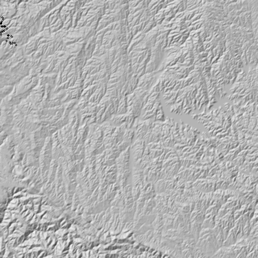

# Zone B-11: Saboia, Odemira, Beja, Portugal

run-002, scenario B, target `moon-psr`.

**Outcome: unknown.** No literature found on the relief of this place.

| Value | |
|---|---|
| Centre | 37.5004, -8.4900 |
| Cells, area | 6 cells, 150 km² |
| Median typicality (median of cell medians) | 0.905 (cells: p25 0.863, p75 0.915) |
| Windows: all, compared (unmasked) | 150, 142 (mean masked share 0.05) |
| Windows per cell | 25.0 (a full 5 km cell has about 25) |
| High-confidence cells | 100% |
| Monte Carlo: runs in the sample's top decile | 100% |

Relief only (hillshade of the Copernicus DEM): no optical imagery is used.

## Literature

- Query: `Saboia Odemira serra relevo xisto vales encaixados Baixo Alentejo`
- Finding: Only a tourism blog places Saboia in the mountainous Serra de Monchique area; no geological or relief source on the zone.
- Sources: <https://www.infopedia.pt/$odemira>, <https://aldeiasportuguesas.pt/beja/odemira/saboia/>
