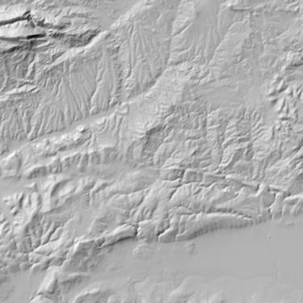

# Zone B-12: Pazarcık, Kahramanmaraş, Akdeniz Bölgesi, 46700, Türkiye

run-002, scenario B, target `moon-psr`.

**Outcome: unknown.** No literature found on the relief of this place.

| Value | |
|---|---|
| Centre | 37.5311, 37.4827 |
| Cells, area | 3 cells, 75 km² |
| Median typicality (median of cell medians) | 0.900 (cells: p25 0.891, p75 0.905) |
| Windows: all, compared (unmasked) | 75, 70 (mean masked share 0.07) |
| Windows per cell | 25.0 (a full 5 km cell has about 25) |
| High-confidence cells | 100% |
| Monte Carlo: runs in the sample's top decile | 100% |

Relief only (hillshade of the Copernicus DEM): no optical imagery is used.

## Literature

- Query: `Pazarcık Kahramanmaraş topoğrafya jeomorfoloji dağlık engebeli arazi`
- Finding: Studies of the Gölbaşı depression and the 2023 earthquake; no relief description of the zone.
- Sources: <https://en.wikipedia.org/wiki/Pazarc%C4%B1k>, <https://acikbilim.yok.gov.tr/handle/20.500.12812/207788>
