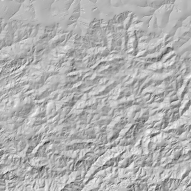

# Zone B-14: Santa Cruz de Salinas, Minas Gerais, Região Sudeste, 39563-000, Brasil

run-002, scenario B, target `moon-psr`.

**Outcome: unknown.** No literature found on the relief of this place.

| Value | |
|---|---|
| Centre | -16.1030, -41.8841 |
| Cells, area | 9 cells, 225 km² |
| Median typicality (median of cell medians) | 0.894 (cells: p25 0.875, p75 0.906) |
| Windows: all, compared (unmasked) | 223, 214 (mean masked share 0.04) |
| Windows per cell | 24.8 (a full 5 km cell has about 25) |
| High-confidence cells | 100% |
| Monte Carlo: runs in the sample's top decile | 100% |

Relief only (hillshade of the Copernicus DEM): no optical imagery is used.

## Literature

- Query: `Santa Cruz de Salinas Minas Gerais relevo chapadas vales Jequitinhonha geomorfologia`
- Finding: Jequitinhonha region: chapadas on old planation surfaces above 650 m, cut by valleys (regional). Nothing on the municipality.
- Sources: <https://rigeo.cprm.gov.br/bitstream/doc/16434/3/mapa_cadastro_aguas_sub_santa_cruz_salinas.pdf>
