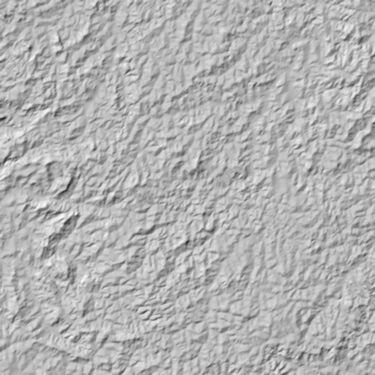

# Zone B-18: Piedade dos Gerais, Minas Gerais, Região Sudeste, 35476-000, Brasil

run-002, scenario B, target `moon-psr`.

**Outcome: unknown.** No literature found on the relief of this place.

| Value | |
|---|---|
| Centre | -20.5054, -44.2853 |
| Cells, area | 23 cells, 576 km² |
| Median typicality (median of cell medians) | 0.890 (cells: p25 0.837, p75 0.901) |
| Windows: all, compared (unmasked) | 571, 542 (mean masked share 0.05) |
| Windows per cell | 24.8 (a full 5 km cell has about 25) |
| High-confidence cells | 100% |
| Monte Carlo: runs in the sample's top decile | 100% |

Relief only (hillshade of the Copernicus DEM): no optical imagery is used.

## Literature

- Query: `Piedade dos Gerais Minas Gerais relevo serras morros geologia`
- Finding: Nothing on the municipality; results are about the Serra da Piedade, another range, and Minas Gerais relief in general.
- Sources: <https://www.infoescola.com/geografia/relevo-de-minas-gerais/>
