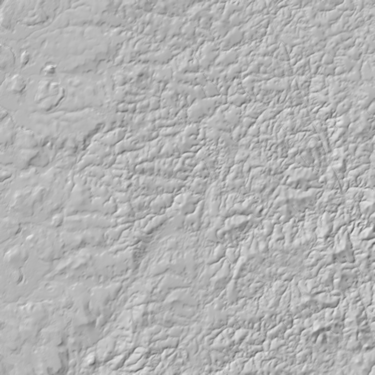

# Zone B-19: Ibiquera, Bahia, Região Nordeste, 46840-000, Brasil

run-002, scenario B, target `moon-psr`.

**Outcome: unknown.** No literature found on the relief of this place.

| Value | |
|---|---|
| Centre | -12.5516, -40.8816 |
| Cells, area | 4 cells, 100 km² |
| Median typicality (median of cell medians) | 0.890 (cells: p25 0.847, p75 0.906) |
| Windows: all, compared (unmasked) | 98, 94 (mean masked share 0.04) |
| Windows per cell | 24.5 (a full 5 km cell has about 25) |
| High-confidence cells | 100% |
| Monte Carlo: runs in the sample's top decile | 100% |

Relief only (hillshade of the Copernicus DEM): no optical imagery is used.

## Literature

- Query: `Ibiquera Bahia relevo Chapada Diamantina serras geomorfologia`
- Finding: The municipality lies in the Chapada Diamantina (IBGE); the Chapada has flat-topped serras cut by narrow valleys (regional). Nothing on the zone.
- Sources: <https://biblioteca.ibge.gov.br/visualizacao/dtb/bahia/ibiquera.pdf>
