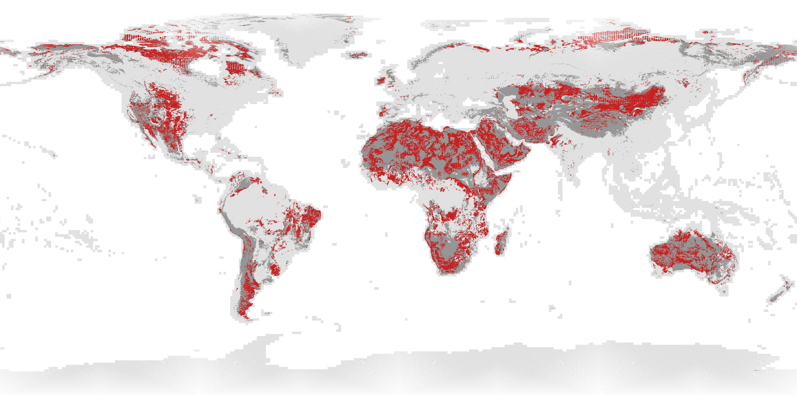

# run-mars-001: first Mars discovery run (T48, 23/11/2026)

Scenario D (Mars exploration and settlement), phase 1 targets, slope only, validated with `validation-protocol-mars-v1` (frozen and tagged before the run). Method and decisions: [methods/mars](../methods/mars.md).

- **Targets:**
  - north and south polar terrain (MOLA 512 pixels per degree, windows of 2.9 km);
  - ice-rich mid-latitudes (MOLA 128 pixels per degree inside SWIM ice consistency Ci > 0, windows of 11.6 km).
- **Earth side:** every land tile of Copernicus GLO-90, resampled to the same pixel and window (E19).
- **Code:** analysis code at the merge commit of T48 (tag `validation-protocol-mars-v1` for the rules).
- **Data:** outputs in `earthmoon-data/run-mars-001/` (not in git); summaries in `data/runs/run-mars-001/`.

## Unfavourable results first

1. **No positive validation.** The only verified controls of scenario D (R29) are volcanic plains, which wait for the Mars geologic map (data improvement R5). The results say where Earth slopes resemble Martian slopes at the MOLA scale, nothing more.
2. **The ranking is not robust: no stable zone.** In 500 Monte Carlo runs with 0.5° slope noise (the protocol value, unchanged), no zone of any target stays in the top decile in 90% of runs. The best zone stays there in 18% (ice-rich), 29% (north polar) and 30% (south polar) of runs.
   - **Why:** at the MOLA scale Martian slopes are very low (median 0.7 to 0.8°, 5th percentile 0.1 to 0.2°). A 0.5° noise is as wide as most of the reference distribution, so the percentile of a flat Earth window jumps from run to run.
   - **The noise is likely too large for these scales:** a few metres of DEM error over a 463 m pixel is about 0.25° per pixel, and less as a window mean. That is a reason for a protocol mars-v2 with a scale-based noise. It is a proposal for David. Nothing was changed after seeing this result.
3. **Slope alone barely discriminates.** Of the high-confidence, mostly unmasked cells, a large share reaches the nominal τ 0.5:
   - 35% for ice-rich mid-latitudes;
   - 44% for north polar terrain;
   - 35% for south polar terrain.

   Zones at τ 0.5 (at least 3 cells) cover 18.6 to 24.5 million km². "Resembles Mars" here means "low relief at kilometre scale".
4. **Polar targets do not point to polar places.** Earth land above 60° has a *lower* median typicality for the polar targets than the tropics: 0.23 against 0.46 (north) and 0.20 against 0.35 (south). At 2.9 km, Arctic relief (fjords, shield lakes, mountains) is rougher than Martian polar terrain. Slope says nothing about cold or ice: that is the Earth context's role (below).
5. **The top 20 is one target.** All 20 dossiers are ice-rich mid-latitude zones: their medians reach 0.9995, the top of the scale. All 20 are low-relief plains (Sahara and Sahel, Mongolian steppe, Great Plains, Siberian lowlands, Mato Grosso, Kalahari, Patagonian plateau). Zones of all targets are ranked together, a rule fixed before run-001.
6. **Masks check: 17 of 18, as in run-002.** The forest point keeps a hidden share of 0.37 in its 2.9 km window.
7. **Each ice-rich cell holds one window** (the 11.6 km window that holds its centre, protocol mars-v1). A zone counts more cells than independent windows: a zone of 11 cells rests on about 2 windows.

## What was computed

| Step | Result |
|---|---|
| Martian profiles | 132,440 windows per pole (phi ≥ 80°), 1,919 ice-rich windows (Ci > 0); slope medians 0.69°, 0.68°, 0.79° |
| Earth cubes | 26,475 GLO-90 tiles at 115.77 m and at 463.08 m, windows of 25 pixels, 0 failures (1.6 h) |
| Assessed cells | 7,400,488 HEALPix cells (32,138 tiles with their neighbours), 0.51 h, 0 failures |
| Windows per cell | polar 2 to 4 (median 3); ice-rich 1 |
| Confidence high / medium / low | 30.8 / 5.3 / 63.9% |
| At least half the windows hidden | 56.9% |

The Earth pixel at the poles is 115.77 m (a quarter of 463.08 m); the polar MOLA grid is 115.09 m, 0.6% finer.

## Zones

Candidate cells: median typicality ≥ τ, fewer than half of their windows masked, high confidence. A zone needs at least 3 connected cells.

| Target | Zones τ 0.5, 3 cells | Area | τ 0.7, 3 cells | τ 0.9, 3 cells | τ 0.9, 9 cells | Stable in Monte Carlo |
|---|---|---|---|---|---|---|
| Ice-rich mid-latitudes | 11,768 | 18.6 M km² | 13,262 | 13,763 | 4,715 | 0 |
| North polar terrain | 11,847 | 24.5 M km² | 12,770 | 11,149 | 2,675 | 0 |
| South polar terrain | 12,166 | 19.1 M km² | 13,388 | 7,181 | 1,169 | 0 |

The zone count rises from τ 0.5 to 0.7: large zones split into several.

Maps (grey: evaluated; light grey: hidden or mostly masked; red: cells of a zone):

| | |
|---|---|
|  Ice-rich mid-latitudes |  North polar terrain |

## Unexpected candidates (dossiers)

The 20 best zones, one dossier each in `run-mars-001/zones/` (hillshade of Copernicus GLO-90, place name, cell medians). Every place was searched. The rule was written before reading the results: a match needs a source naming the place itself as an analog of the target environment, or describing its relief as the target's profile does. The queries, findings and sources are in `data/runs/run-mars-001/literature.json`.

| Outcome | Zones |
|---|---|
| Explained artefact | 0 (no flattened lake or DEM void in the hillshades) |
| Plausible | 0 |
| Unknown | 20 |

Two places are named as analogs of *other* Martian environments, not of ice-rich ground:
- the Tindouf Basin (D-13), for Noachian soil geochemistry;
- the Santa Cruz valley below Lago Argentino (D-20), for outflow-channel megafloods.

## Earth context of the assessed cells (E18, models)

- **Frozen ground (E4, −6 °C):** met 3.2%, partial 4.6%, failed 27.9%, not covered south of 25°N 64.3%.
- **Aridity:** hyper-arid 5.3%, arid 12.6%, semi-arid 12.0%, dry sub-humid 6.5%, humid 37.2%, no data 26.3%.

This context is the dimension that speaks of cold and dryness. It is shown beside slope, never combined with it (E18).

## Validation (protocol mars-v1)

| Check | Rule | Result | Pass |
|---|---|---|---|
| Positives | median ≥ 75th percentile | none exist for phase 1 targets | no validation |
| Negatives in the top 10% | at most 1 of 18 per target | 0 for every target | yes |
| Masks | 18 of 18 masked or flagged | 17 of 18 | **no** |
| Self-consistency | KS ≤ 0.05 | ice-rich 0.026, north 0.004, south 0.008 | yes |
| Reproducibility | identical SHA-256 on rebuild | 5 of 5 tiles at 115.77 m, identical cell rows | yes |

**Bias:**
- Candidates follow the evaluated land. Africa holds the most: 35% of its evaluated cells for ice-rich ground, 46% for north polar terrain.
- Antarctica has almost no evaluated cell (151 to 986), likely because rock outcrops rarely fill half of a window this large (not checked).
- Tables are in `data/runs/run-mars-001/validation.json`.

## What this run cannot show

- That a zone is a good Mars analog for a team (only a field campaign can).
- Anything but slope at kilometre scale: no mineralogy, ice, thermal inertia, dust or wind yet (data improvements R1 to R8).
- Relief below the MOLA pixel, where rover-scale analogs live (HiRISE, R3).
- Places where the ground is hidden (57% of the assessed cells).

## Proposed next steps (for David)

- **Protocol mars-v2:** a slope noise derived from the DEM error at each scale, decided before any rerun.
- **Volcanic plains with the Tanaka map (R5):** the only target with positive controls.
- **MOLA-HRSC at 200 m (R1):** windows of 5 km at mid-latitudes, closer to the lunar 1 km.
