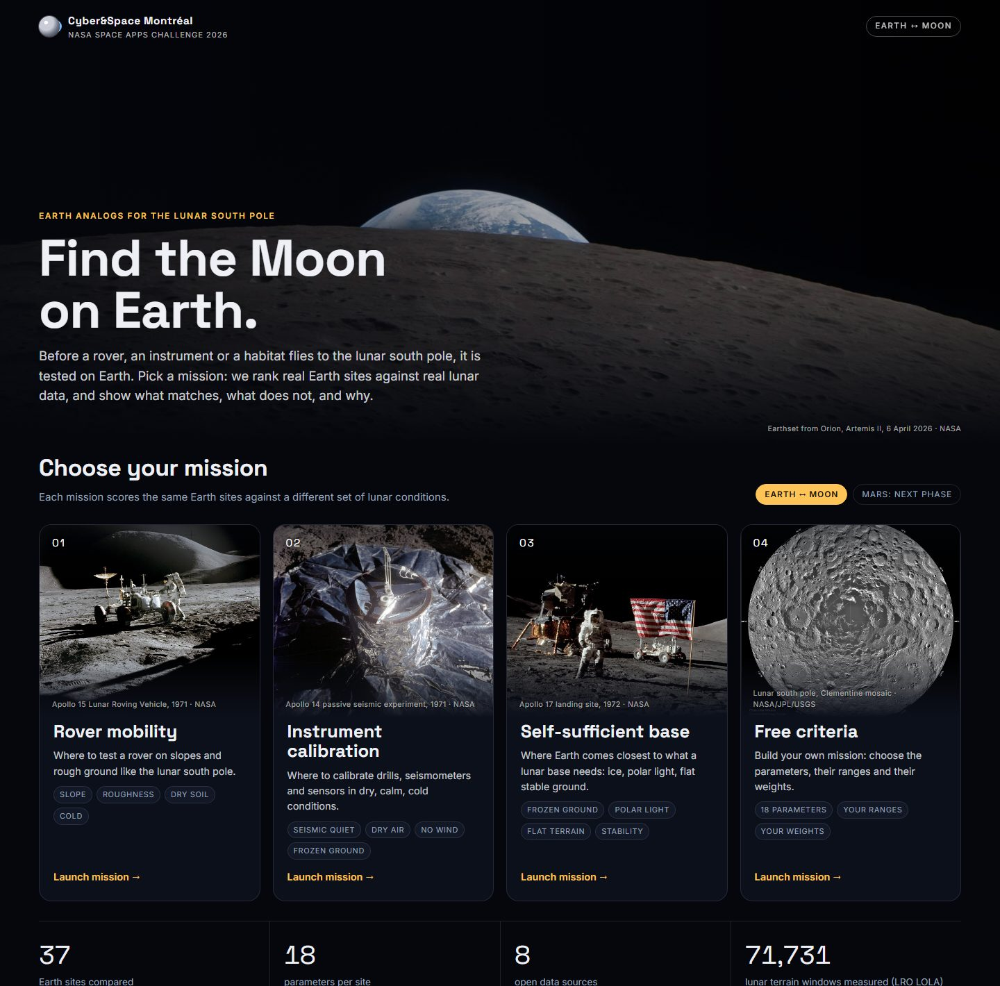
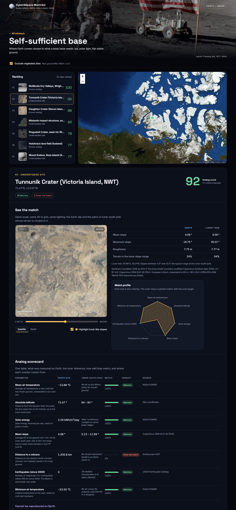

# 🛰️ Lunar Twins on Earth

**NASA Space Apps Challenge 2026 · Cyber&Space Montréal** · Challenge: [Permanent Moon Base Locations and Mars](https://www.spaceappschallenge.org/2026/challenges/permanent-moon-base-locations-and-mars/)

A web application that ranks Earth sites as analogs of the **lunar south pole** for a chosen mission: rover mobility testing, instrument calibration, a self-sufficient colony, or free criteria. Each site is scored criterion by criterion with open data (NASA POWER, MODIS, Copernicus DEM, USGS, Smithsonian GVP) against lunar reference values (LRO LOLA slope and roughness computed with the same 1 km method as on Earth, LRO Diviner).

It is a **screening tool**: it ranks where to look first and says how solid each rank is. It does not approve a mission or replace field work.

Every site card shows what matches, what does not, the lunar value next to the Earth value, the source of each number, and what Earth cannot reproduce (gravity, vacuum, radiation).

**Live:** https://jolly-rock-05f5cb20f.3.azurestaticapps.net · **API docs:** https://ca-api-rtzkc5ya.bluesky-19c5e80c.canadacentral.azurecontainerapps.io/api/docs




## The four modes

| Mode | Question it answers |
|---|---|
| **Robotics validation** | Where on Earth can a rover's mobility be tested before it goes to a lunar site? |
| **Instrument calibration** | Where can drills, wind, gas, seismic and thermal instruments be calibrated in near-lunar conditions? |
| **Self-sufficient colony** | Which sites reproduce the conditions that make a lunar site favorable to a self-sufficient base (water, energy, terrain, shelter)? |
| **Free criteria** | You choose the parameters, their intervals and their weights (only parameters our sources provide). |

Criteria and their justifications: [docs/scenarios.md](docs/scenarios.md).

## How it works (methodology v2)

- **Scenarios:** each criterion states its role (similarity to a measured lunar distribution, operational requirement, or Earth proxy), the basis of its numbers (lunar measurement, mission requirement or expert judgement) and its rationale. Terrain intervals are the interquartile range of LRO LOLA at the south pole, with the 5th and 95th percentiles as tolerances.
- **Scoring:** score 1 inside the interval, linear decrease to 0 at the tolerance; site score is the weighted mean out of 100 of the criteria that have data. A hard requirement (for example enough ground under 15° for a rover) that fails puts the site after all sites that pass; it is never averaged away. Vegetation lowers the score progressively (NDVI 0.2 to 0.6).
- **Missing data:** a missing value counts neither for nor against a site; each result gives its coverage and the range of the score if the missing values were known.
- **Confidence:** 500 Monte Carlo scenarios perturb weights, tolerances, bounds and every site value with a quantified uncertainty. Each site gets a rank range, a score interval and a confidence label, separate from the score.
- **Data:** one frozen, versioned data set (`data/dataset-v2.json`): Copernicus DEM on the same 40 m grid as the lunar model, MODIS, and NASA POWER (temperatures corrected to the site elevation), USGS (M ≥ 4.5) and Smithsonian GVP frozen on a known date. Every result carries the method and data versions.
- **Candidates:** 37 sites: 9 known analogs, 1 negative control (Amazon) and 27 candidate sites. They are hypotheses, not discoveries.

Scientific documentation: [audit of v1](docs/SCIENTIFIC_AUDIT.md) · [methodology](docs/SCIENTIFIC_METHODOLOGY.md) · [references](docs/SCIENTIFIC_REFERENCES.md) · [roadmap](docs/SCIENTIFIC_ROADMAP.md) · [before / after validation](docs/SCIENTIFIC_VALIDATION.md) · [limits and expert decisions](docs/SCIENTIFIC_LIMITATIONS.md). Sources and attributions: [docs/sources.md](docs/sources.md), or `GET /api/sources`.

## Validation

Known analogs are expected in the top half of the modes they are actually used for; the Amazon control must be excluded or last. With methodology v2, **8 of 11 expectations are met (73%, below the 75% threshold)**; v1 met 9. The misses are explained by measurements (Holuhraun is flatter than the lunar south pole at 1 km; Atacama lies on an active subduction margin). The expectations were written by the team, so this is a consistency check, not an independent benchmark, and v2 was not retuned to meet it. Details: [docs/validation.md](docs/validation.md) and [docs/SCIENTIFIC_VALIDATION.md](docs/SCIENTIFIC_VALIDATION.md).

## Limits of the analogy

Earth cannot reproduce lunar gravity, vacuum, absence of wind or radiation, and no site approaches the cold of permanently shadowed craters; temperature criteria are proxies. Every site card says what the analogy does not cover. Biology and habitability are out of scope. Not yet modelled: lighting at the pole (the Sun stays within 1.5° of the horizon), lithology (the highlands are anorthosite), regolith mechanics and dust, terrain below the 40 m DEM scale, communications and logistics. Until they are, a high score means "worth a closer look", not "good test site".

## Run it

```bash
docker compose up --build        # front end http://localhost:8080, API http://localhost:3001/api/docs
python3 tools/validation/e2e.py  # end-to-end tests against the running app
```

Stack: React, TypeScript, Vite, Tailwind, Leaflet · Node.js, TypeScript, Express, OpenAPI · Python (precompute, validation) · Docker, Terraform, Azure (Static Web App, Container Apps). Details: [docs/architecture.md](docs/architecture.md).

## Use of AI

The team defined the mission modes and the validation approach. Parts of the code, data processing scripts, tests and documentation were written with the help of Claude (Anthropic) and Microsoft Copilot, under the team's direction; commits made with Claude carry a `Co-Authored-By: Claude` trailer. No image, video or audio was generated with AI.

## Team

Cyber&Space Montréal: François, Jesus, Wassim, Yann, Xavier, David.
